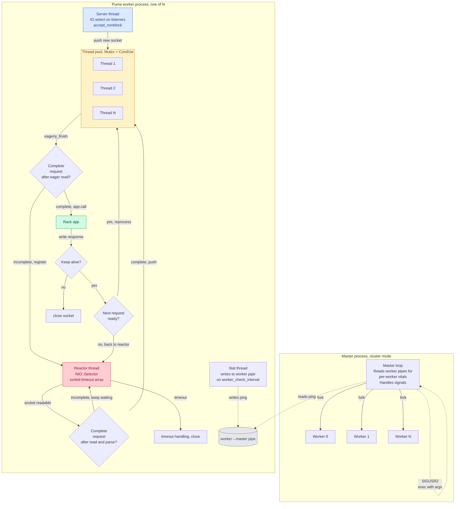
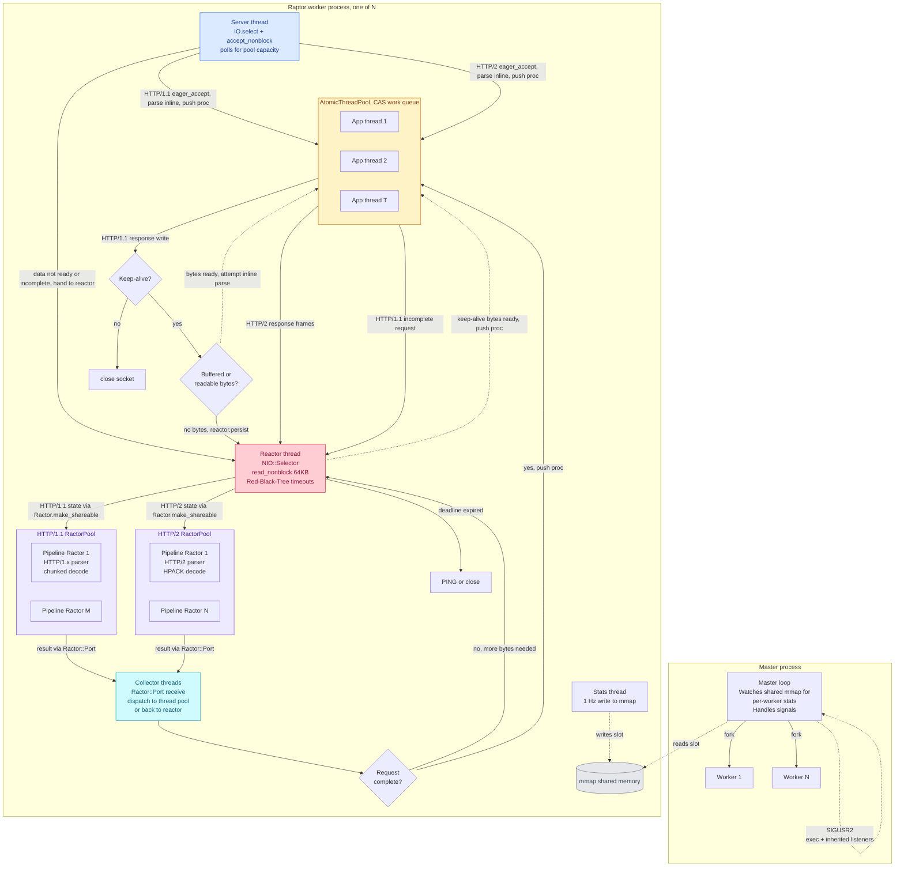

# Raptor vs Puma

Puma and Raptor both run Rack applications on threads inside worker processes. Their main differences are how they handle protocol work, admit connections, and support long-lived responses. Raptor also implements HTTP/2. Puma leaves that to a proxy.

Raptor began as an experiment with Ruby's Ractors and is still a young server. Puma has a long production history and a much larger operational ecosystem.

This guide compares their architecture and relates it to the [current README benchmarks](../README.md#micro-benchmarks). Those benchmarks measure the whole server, so architectural differences alone do not explain individual results.

## At a glance

| Dimension | Puma | Raptor |
| --- | --- | --- |
| Ruby requirement | 3.0 and up | 4.0 and up |
| Process model | Single process or cluster | Preloaded, pre-fork cluster only |
| Application execution | Thread pool within each worker | Thread pool within each worker |
| Protocol processing | App threads and reactor share the worker's GVL | Eager parsing inline, separate protocol Ractors on the pipeline path |
| Pool coordination | Mutex and condition variables | Lock-free work queue with idle-thread parking |
| Pool growth | Adds threads when queued work exceeds waiting capacity | Adds threads when queued work and blocking time justify growth |
| Idle and partial connections | `nio4r` reactor | `nio4r` reactor |
| Cluster dispatch | Shared listeners with load-sensitive accept delay | Shared listeners, plus load-aware BPF dispatch on supported Linux TCP bindings |
| HTTP/2 | Not implemented | Native parsing, HPACK and stream flow control |
| Worker monitoring | Pipe messages | Shared-memory stats |

The application does not need to be Ractor-safe to use Raptor. Rack runs on ordinary threads in the worker's main Ractor. It still needs to be thread-safe, just as it does with a multithreaded Puma configuration.

Falcon is a useful third comparison. It uses fibers through the `async` ecosystem and supports HTTP/2. Fibers can keep many requests in flight without assigning each one an OS thread. That depends on application I/O cooperating with the fiber scheduler. The README includes Falcon, but this is not a full comparison of its design.

## How Puma moves a request

In cluster mode, a master supervises worker processes. Each worker accepts connections and has its own application thread pool. Puma can preload the application before forking so workers initially share memory through copy-on-write. It can also run without a cluster.

With the default request queueing enabled, a newly accepted socket first goes to the thread pool. An app thread tries to read and parse a complete request without waiting for more bytes. If it succeeds, it calls Rack and writes the response. If the request is incomplete, it returns the socket to the reactor and becomes available for other work.

The reactor watches partial requests and idle keep-alive connections. When bytes arrive, it can read and parse them through the client object. Once the request is complete, it queues the client for an app thread. Puma's native HTTP/1 parser therefore runs on both app threads and the reactor path. All of that Ruby coordination shares the worker's GVL with the application.

After a response, Puma can handle a ready follow-up request on the same app thread when pool capacity allows. Otherwise it queues the client again or returns an idle connection to the reactor. An idle keep-alive connection does not need to hold an application thread.

### Puma request flow

This diagram shows the normal queued HTTP/1.1 path in cluster mode. The keep-alive branch is simplified. Ready requests may continue inline or be queued again.

## How Raptor moves a request

Raptor always preloads the app and forks workers. Each worker has an accept thread, a reactor, protocol Ractors and their collector threads, an app thread pool, and a stats thread. HTTP/2 bindings add a separate HTTP/2 protocol pool.

There are two important request paths.

1. **Eager handling.** On a plain HTTP/1.1 connection, the accept thread tries to read and parse the request immediately. A complete request goes straight to the app pool. TLS connections perform their handshake and initial protocol handling on an app thread instead.
2. **Protocol pipeline.** If more bytes are needed, the reactor watches the socket and reads available data. A protocol Ractor parses the buffered state. A collector routes the result back to the reactor for more data or to the app pool for Rack execution.

Protocol Ractors can execute in parallel with the main Ractor. The Rack application cannot use that parallelism for its own Ruby execution. Its threads still share the main Ractor's GVL within each worker. Multiple worker processes provide application-level Ruby parallelism in both servers.

Raptor does not send every request through a Ractor. After an HTTP/1.1 response, an app thread checks for the next request without waiting. It can parse ready bytes inline and yield to queued work when needed. If the connection is idle, it returns to the reactor. When that connection becomes readable, the reactor first sends it back to an app thread for another eager attempt. Only an incomplete request needs the longer parsing pipeline.

The distinction matters. Separate parsing can overlap protocol work with Rack execution, but crossing Ractor and collector boundaries also costs work. Eager paths avoid those handoffs. The benchmark does not isolate either path's contribution.

### Raptor request flow

The eager accept arrows below show plain connections. TLS setup takes an app-thread detour before protocol dispatch. HTTP/2 response writes return to the reactor. Ordinary HTTP/1.1 responses are written by app threads.

## Where the designs differ

### Thread pools and admission control

Puma coordinates its work queue and pool bookkeeping with a mutex and condition variables. It can grow from a minimum to a maximum thread count as work arrives. Idle threads sleep.

Raptor uses `AtomicThreadPool` from `atomic-ruby`. Enqueue and dequeue use a lock-free queue. Idle threads still park rather than spin. Its adaptive pool considers time spent executing Ruby, waiting for the GVL, and blocked outside it. Growth is intended to help blocking workloads without adding threads just because CPU-bound Ruby work is queued. The default has no upper limit, so deployments should choose a cap where resource limits require one.

Raptor also checks queued and active work before accepting more connections. Under pressure, the accept loop yields and polls for capacity rather than parking until notified. This can consume CPU while the worker is saturated. It limits new accepts, not requests arriving on existing keep-alive connections. It is not a guarantee of progress or fairness for every client.

Puma's cluster accept delay backs off according to worker load. On supported Linux plain TCP bindings, Raptor can instead use BPF reuseport dispatch to choose the less loaded of two sampled workers. Its load estimate includes pending accepts. TLS and Unix sockets use shared listeners. Missing BPF prerequisites also leave Raptor on shared listeners, while a kernel rejection of the BPF program fails startup.

### Connection tracking

Both reactors keep idle and partial connections off application threads. Puma tracks deadlines in a sorted array. Raptor uses a red-black tree for logarithmic insertion and removal of individual deadlines. Updating a connection's deadline does not require scanning the other connections.

### Responses and streaming

Ordinary HTTP/1.1 response writing runs on app threads in both servers. Raptor can gather headers and array-body buffers with `writev` and reuse per-thread response buffers. Puma uses its own buffered writes and Linux TCP corking. Both support file bodies and enumerable streaming bodies.

A blocking Enumerator occupies an app thread while it waits and yields, in either threaded server. Raptor also provides `Raptor::DetachedBody`. It hands a long-lived response to the reactor and releases the app thread. Later writes use bounded buffers and must handle backpressure. This is a Raptor-specific API, not an automatic improvement for every existing streaming Rack app.

The SSE benchmark uses detached bodies for Raptor and blocking Enumerators for Puma and Falcon. It also runs Raptor with the same Enumerator body as a control. Falcon's fiber scheduler can yield during those sleeps without occupying an OS thread per stream.

### HTTP/2

Raptor supports HTTP/2 over TLS with ALPN and cleartext prior-knowledge HTTP/2 on `h2c://` listeners. Completed streams enter the same Rack thread pool as HTTP/1.1 requests. Multiple streams can be in flight on one connection, but their application Ruby still shares the worker's main-Ractor GVL.

The reactor owns HTTP/2 socket writes after setup. App threads queue frames rather than competing to write directly to the shared connection. Ordinary bodies can still wait for stream or connection flow-control capacity. Detached bodies return the app thread and let the reactor schedule buffered output as capacity becomes available.

Puma does not implement HTTP/2. Its [position](https://github.com/puma/puma/issues/2697) is to leave it at the edge. If a proxy terminates HTTP/2 and forwards HTTP/1.1, native HTTP/2 in the app server is not part of that request path. It matters when clients or proxies actually use HTTP/2 to Raptor. Falcon is the direct benchmark comparison for that case.

### Supervision and restarts

Both servers support phased worker replacement and hot restarts that preserve listening sockets. Raptor publishes routine worker stats through shared memory, while Puma uses pipe messages.

Raptor's Linux reforking promotes a warmed worker into a dedicated fork source. New workers can share its warmed state through copy-on-write. Puma also offers worker reforking. Reforking needs care around application threads, database connections and inherited resources. Raptor's benchmark disables it, so the reported memory results do not measure its benefit.

## What the current benchmarks show

The README is the source of truth for versions, full tables and reproduction instructions. The current run compares Raptor 0.23.0, Puma 8.0.2 and Falcon 0.57.0 on Ruby 4.1 development head with YJIT on Linux. It uses ten workers, 120 HTTP/1.1 client connections, or 40 HTTP/2 connections with three streams each.

Each case has three fresh-process samples, interleaved in seeded shuffled rounds. Each sample has a three-second warmup and a fifteen-second measurement. Throughput, p95 and resource figures are independent medians. The reported spread is half the observed range divided by the median, not a confidence interval.

The IO workload interleaves short sleeps with small JSON renders. The CPU workload interleaves larger JSON renders with much shorter sleeps. Both discard the rendered JSON and return a short response. They simulate application work, not a database or a complete Rails stack. A separate prebuilt 64 KiB body exercises response transfer.

Raptor and Puma run with three fixed threads or scale from three to sixteen. The keep-alive IO case also tests sixteen prestarted threads. Falcon uses unbounded fibers. Raptor's request-local cleanup, CPU affinity and reforking are disabled, as is Puma's Fiber-per-request mode. These results do not describe every default configuration.

CPU ms/request includes the master and descendants, including SSE event production, but excludes client CPU and warmup. It is divided by successful ordinary requests. Peak aggregate PSS is sampled every half second and apportions shared pages rather than counting them fully in each worker. This is a short-run memory measurement, not a long-term capacity estimate.

### IO over HTTP/1.1

With three fixed threads, Raptor delivers about 2.2–2.3 times Puma's throughput, with and without keep-alive. That comes with roughly 2.4–2.5 times the server CPU per successful request.

With scaling enabled, their throughput and p95 are close. The keep-alive fixed-sixteen control is also close to both scaling results. Pool capacity changes the comparison substantially.

Falcon leads the fresh-connection IO run. With keep-alive, Falcon and the larger threaded pools are roughly tied in throughput.

### CPU over HTTP/1.1

The CPU results are mixed. On fresh connections, fixed Raptor reaches 3.61k req/s against Puma's 3.29k. Scaling Raptor reaches 3.54k against 2.89k. Raptor leads throughput by about 10% and 23% respectively, but its p95 is higher in both modes.

With keep-alive, fixed Puma leads throughput at 3.61k against Raptor's 3.12k, and also has lower p95. Scaling Raptor leads at 3.09k against Puma's 2.88k, with about 20% lower p95. Puma uses less CPU per successful request in both keep-alive cases. On fresh connections, CPU per request is close.

Raptor's throughput spread is between ±1.2% and ±4.6% across these four cases.

### The 64 KiB response

This scaling keep-alive case is a clear measured strength for Raptor. It was rerun on Ruby 4.1-dev revision `33ac6afea7`; the other cases use `cda3527671`.

| Metric | Raptor | Puma |
| --- | --- | --- |
| Successful req/s | 102.11k | 88.55k |
| p95 | 3.37 ms | 3.63 ms |
| CPU per successful request | 0.047 ms | 0.054 ms |
| Peak aggregate PSS | 513.5 MiB | 1371.1 MiB |

Raptor serves about 15% more requests per second, with 7% lower p95, 13% less CPU per request and 63% less peak PSS. Throughput spread is ±0.4% for Raptor and ±0.6% for Puma. The prebuilt body avoids JSON-generation work. This result does not predict memory use for other response sizes or applications.

### IO alongside SSE

The harness opens twenty streams across the cluster, not two guaranteed streams on each worker. It keeps them connected while measuring ordinary IO requests. A stream without complete response headers after two seconds is counted as stalled and remains connected. Throughput counts successful ordinary requests only, not events or timed-out requests. Failure counts sum all three samples.

With three fixed threads, native detached Raptor serves 3.46k req/s against Puma's 0.35k, nearly ten times the throughput. Puma records 54 timeouts and one stalled stream. Raptor's matched Enumerator control falls to 0.89k, with 21 timeouts. The control shows that the native result is not representative of running the same blocking streaming body on Raptor.

With scaling enabled, native Raptor serves 7.48k req/s against Puma's 7.14k, about 5% ahead. Its p95 is about 5% lower, but it uses more CPU per successful request. Detached streaming frees application threads, but the benefit depends on how much thread capacity the rest of the workload needs.

### HTTP/2 against Falcon

On the CPU workload, Raptor reaches 3.37k–3.70k req/s against Falcon's 2.79k, a median throughput lead of about 21–33%. Its p95 is lower, but Falcon's throughput spread is ±25.3%. Falcon's samples range from 2.37k to 3.78k req/s, so the median lead is not consistent across all samples. Raptor also uses more CPU per successful request and has higher peak PSS.

For IO, scaling Raptor and Falcon are roughly tied at 7.17k and 7.13k req/s. Raptor has about 11% higher p95, 28% more CPU per successful request and 85% higher peak PSS at 916.8 MiB against 496.1 MiB. Its throughput spread is ±11.3%. With three fixed threads, Raptor falls behind at 1.59k req/s.

These tests include TLS, multiplexing and flow control. Raptor's plain-TCP BPF path is not used for this TLS listener.

## Limits and choosing a server

Puma is the safer default when production history, broad Ruby compatibility and operational familiarity matter most. Its simpler request path also has fewer Ractor boundaries to trace when debugging.

Raptor requires Ruby 4 or newer and has more coordination machinery per worker. Pipeline requests pay for shareable state and cross-Ractor handoffs. Several core pieces depend on libraries developed alongside Raptor, including `atomic-ruby`, `ractor-pool`, `red-black-tree` and `mmap-ruby`. Their adoption and testing history are not equivalent to Puma's.

The published run uses development Ruby, not the minimum supported Ruby version. Ractor and runtime behavior can change between versions. Benchmark the version you intend to deploy rather than assuming these numbers apply to Ruby 4.0 or a later release.

Raptor's cluster-only model also carries process and coordination costs in a small container. Direct HTTP/2 and detached streaming are useful only when the deployment or application uses them. A synthetic fifteen-second run does not establish long-term stability, memory behavior, overload recovery or production readiness.

Try Raptor with your thread-safe Rack application, especially if direct HTTP/2 or detached streaming would be useful. Measure throughput, latency, CPU, memory and failures alongside the server you use today.

Include Falcon when the application and its dependencies work well with fiber scheduling, especially for concurrent I/O or long-lived connections. Choose from measurements of your application and your operational constraints, not one benchmark leaderboard.
