# Raptor

## A Ruby 4 Web Server

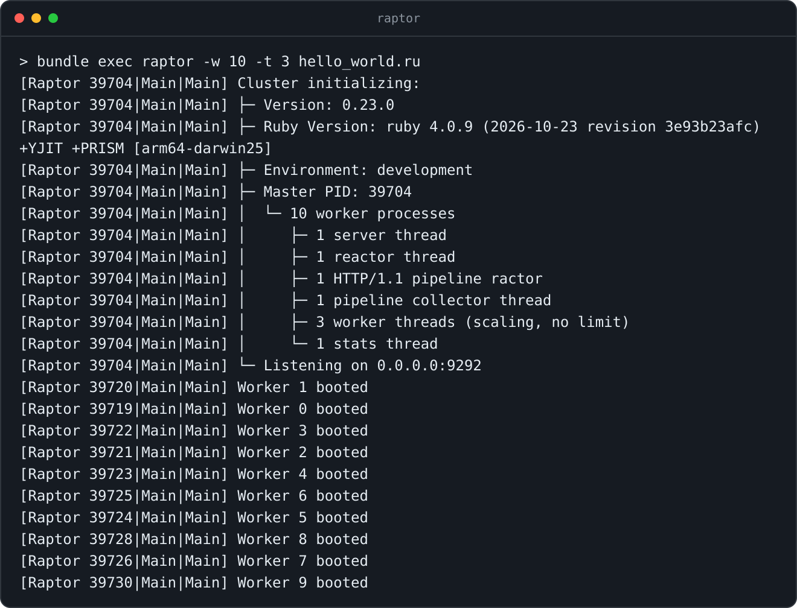


_Joshua Young ([`@joshuay03`](https://github.com/joshuay03))_

_Senior Software Engineer at [Buildkite](https://buildkite.com/)_

_[Rails](https://github.com/rails/rails) Issues team member_

_[Puma](https://github.com/puma/puma), [Concurrent Ruby](https://github.com/ruby-concurrency/concurrent-ruby), and [Vernier](https://github.com/jhawthorn/vernier) maintainer_

<hr width="35%" align="left">

_[BrisRails](https://luma.com/t3l24s8h) · August 2026_

_[Ruby Melbourne](https://www.meetup.com/ruby-melbourne/events/313408465/) · October 2026_

<br clear="all" />

<br>
<br>
<br>
<br>
<br>
<br>
<br>
<br>

---

<br>
<br>
<br>
<br>
<br>
<br>
<br>
<br>

## How Raptor started

<big>Working on Puma made me curious about what a web server built around Ractors could look like.</big>

<big>That became Raptor. It runs Rack apps, Rails included, and parses HTTP in parallel using Ractors.</big>

<big>**Your app doesn't need to be Ractor-safe.** It runs on ordinary threads,
with the same thread-safety requirements as multithreaded Puma.</big>

<big>It's still young, and I'd love more people to try it on their apps and tell me what works and what doesn't.</big>

Today we'll look inside Raptor at its Ractors, lock-free queues, red-black trees,
shared memory, and a tiny program running inside Linux.

<br>
<br>
<br>
<br>
<br>
<br>
<br>
<br>

---

<br>
<br>
<br>
<br>
<br>
<br>
<br>
<br>

## What a web server actually does

[Rack](https://github.com/rack/rack) gives us a small boundary between the server and your app.

```ruby
# A complete Rack app. Nothing more is needed.
run ->(env) { [200, { "content-type" => "text/plain" }, ["hello\n"]] }
```

<big>Your app responds to `call`. It takes a request hash, the "Rack env", and returns `[status, headers, body]`.</big>

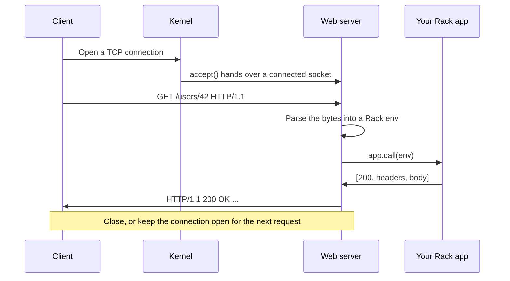

<big>The kernel handles TCP. The server handles HTTP.</big>

<br>
<br>
<br>
<br>
<br>
<br>
<br>
<br>

---

<br>
<br>
<br>
<br>
<br>
<br>
<br>
<br>

## The two servers you already know

**[Puma](https://github.com/puma/puma)**

<big>Worker processes, each with a pool of threads. It's HTTP/1.1 only, battle-tested, and the one I know best.</big>

**[Falcon](https://github.com/socketry/falcon)**

<big>Built on [`async`](https://github.com/socketry/async). It uses fibers instead of a thread pool, speaks HTTP/2, and is great at streaming.</big>

Fibers are another concurrency model. Raptor keeps your thread-safe Puma app on ordinary threads,
without requiring app changes.

<br>
<br>
<br>
<br>
<br>
<br>
<br>
<br>

---

<br>
<br>
<br>
<br>
<br>
<br>
<br>
<br>

## The Ruby 4 opening

<big>Ractors have been around since Ruby 3.0, but the API kept changing, so most of us never touched them.</big>

<big>[Ruby 4.0](https://www.ruby-lang.org/en/news/2025/12/25/ruby-4-0-0-released/#ractor-improvements) introduced `Ractor::Port`.
Many Ractors can send to one receiver. A good fit for "many workers, one collector".</big>

<big>They're still marked experimental, but [Ruby 4.1 adds Ractor-local garbage collection](https://www.ruby-lang.org/en/news/2026/10/12/ruby-4-1-0-preview1-released/#ractor-improvements), so most collections no longer stop all the Ractors.</big>

<br>
<br>
<br>
<br>
<br>
<br>
<br>
<br>

---

<br>
<br>
<br>
<br>
<br>
<br>
<br>
<br>

## Ractors in one slide

Ruby threads normally share a Global VM Lock (GVL), so only one of them can run Ruby code at a time.

A Ractor is an isolated area of Ruby with **its own GVL**, so two Ractors can run Ruby on two cores at the same time.

The catch is isolation. A Ractor can't reach into its surroundings.

```ruby
data = { name: "hello" }

Ractor.new { puts data }
# Error: the block accesses an outer variable (data).
```

Instead, Ractors pass messages.

```ruby
port = Ractor::Port.new

worker = Ractor.new(port) do |port|
  loop { port.send("processed: #{Ractor.receive}") }
end

worker.send("hello")
port.receive # => "processed: hello"
```

<big>Shareable values, like deeply frozen arrays and hashes, are shared as is. Mutable values are copied, or moved with `move: true` so the sender can no longer use them.</big>

<big>Isolation keeps ordinary mutable objects from being changed by two Ractors at once.</big>

<br>
<br>
<br>
<br>
<br>
<br>
<br>
<br>

---

<br>
<br>
<br>
<br>
<br>
<br>
<br>
<br>

## What Ractors are good for

They won't make your Rails app parallel on their own. Rails and many of its gems aren't Ractor-safe.

<big>They suit small, CPU-heavy jobs that are easy to hand off, without relying on global state or Ractor-unsafe gems.</big>

That describes HTTP parsing exactly.

<br>
<br>
<br>
<br>
<br>
<br>
<br>
<br>

---

<br>
<br>
<br>
<br>
<br>
<br>
<br>
<br>

## The idea

In Puma, parsing and your app share the worker's GVL, even when they run on different threads.

If parsing runs in a Ractor instead, it gets its own GVL.

```mermaid
---
config:
    gantt:
        leftPadding: 220
---
gantt
    title One worker process, over time (illustrative)
    dateFormat x
    axisFormat %L ms

    section Puma (one GVL)
    Parse request A     :0, 2
    App handles A       :2, 8
    Parse request B     :8, 10
    App handles B       :10, 16

    section Raptor (app GVL)
    App handles A       :2, 8
    App handles B       :8, 14

    section Raptor (parser Ractor GVL)
    Parse request A     :0, 2
    Parse request B     :2, 4
```

<big>While your app handles request A, a Ractor is already parsing request B. Your app stays on normal threads, so it doesn't need to be Ractor-safe.</big>

If a whole request arrives in one read, Raptor skips the Ractor and parses it straight away.

<br>
<br>
<br>
<br>
<br>
<br>
<br>
<br>

---

<br>
<br>
<br>
<br>
<br>
<br>
<br>
<br>

## Raptor at a glance

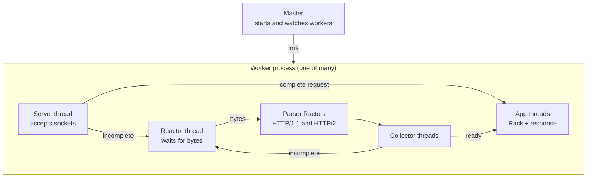

Let's walk through each piece.

<br>
<br>
<br>
<br>
<br>
<br>
<br>
<br>

---

<br>
<br>
<br>
<br>
<br>
<br>
<br>
<br>

## The Ractor pools

Each protocol gets its own pool of parser Ractors.
With multiple parsers, a coordinator hands work to whichever is free.

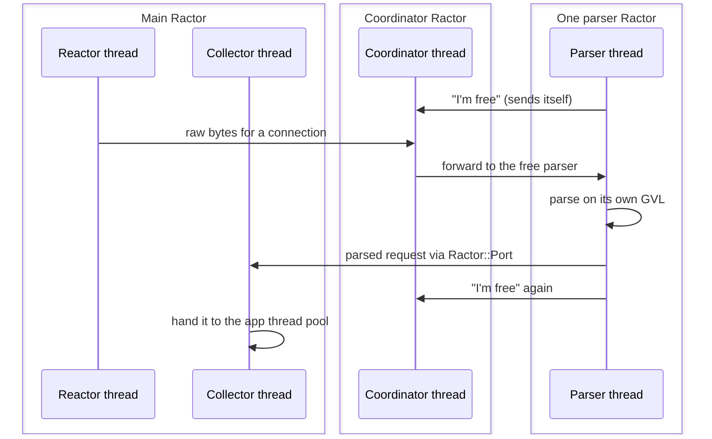

<big>Idle parsers send **themselves** back to the coordinator, so it always knows who's free without polling or busy-waiting.</big>

<big>The parsers are Ractor-safe C extensions, and common header names are created once and reused.</big>

I pulled this pattern out into its own gem, **[`ractor-pool`](https://github.com/joshuay03/ractor-pool)**.

<br>
<br>
<br>
<br>
<br>
<br>
<br>
<br>

---

<br>
<br>
<br>
<br>
<br>
<br>
<br>
<br>

## The app thread pool

This is where your Rack app runs.

Puma's work queue is guarded by a `Mutex`. Adding and taking work both acquire it.

Raptor's work queue has **no mutex**. To explain how, we need one tiny CPU instruction.

<br>
<br>
<br>
<br>
<br>
<br>
<br>
<br>

---

<br>
<br>
<br>
<br>
<br>
<br>
<br>
<br>

## Compare-and-swap (CAS)

"Set this value to **new**, but only if it's still **expected**." The CPU does it as one indivisible step.

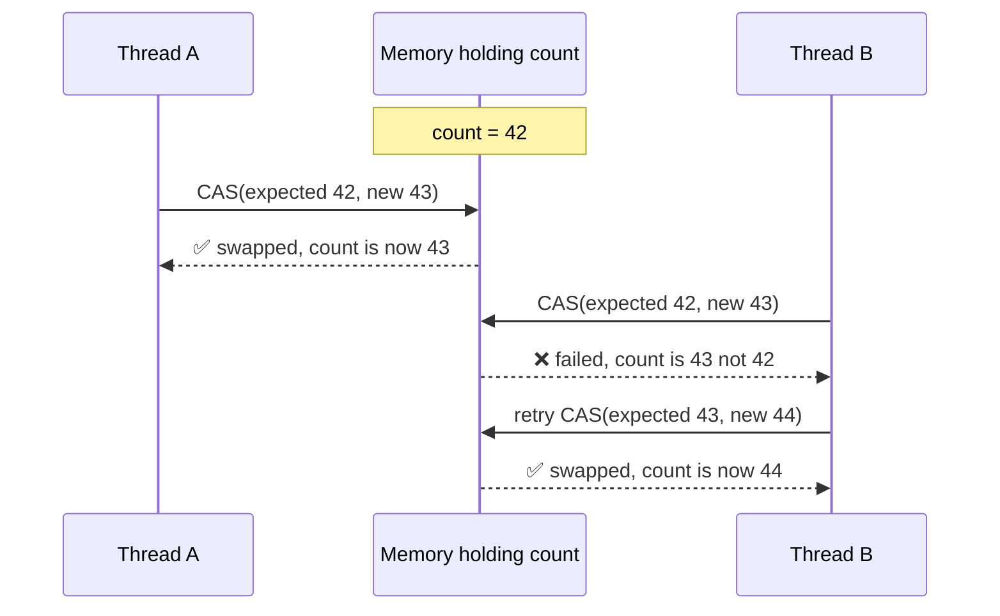

<big>Nobody waits on a lock. The loser just retries with the fresh value.</big>

<big>The catch is that it works on one value at a time, like a counter, a flag, or the head of a queue.</big>

A mutex is still simpler for bigger critical sections. CAS pays off on hot paths.

I wrote a native gem that brings these primitives to Ruby, **[`atomic-ruby`](https://github.com/joshuay03/atomic-ruby)**.

<br>
<br>
<br>
<br>
<br>
<br>
<br>
<br>

---

<br>
<br>
<br>
<br>
<br>
<br>
<br>
<br>

## A queue with no lock

Raptor's work queue is [`atomic-ruby`](https://github.com/joshuay03/atomic-ruby)'s `AtomicQueue`, a lock-free linked list where each step is a single CAS.

**Adding work C**

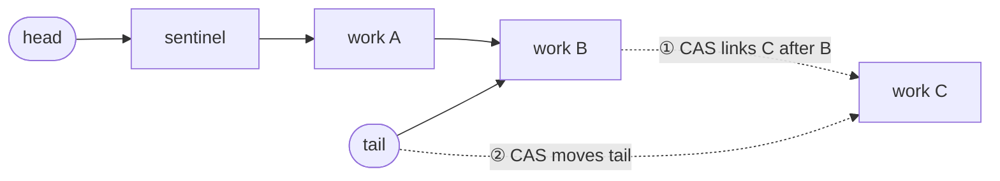

**Taking work**

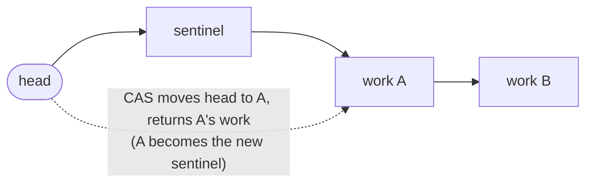

<big>Adding and taking never block each other. If two threads race, one CAS wins and the other retries.</big>

<br>
<br>
<br>
<br>
<br>
<br>
<br>
<br>

---

<br>
<br>
<br>
<br>
<br>
<br>
<br>
<br>

## No mutexes in Raptor's own code

There isn't a single `Mutex` in Raptor's own code. Shared state is either owned by one thread, passed along as a message, or updated with CAS.

That's not only about speed. Under the GVL, a thread can be switched out at almost any point,
including while it's holding a lock.

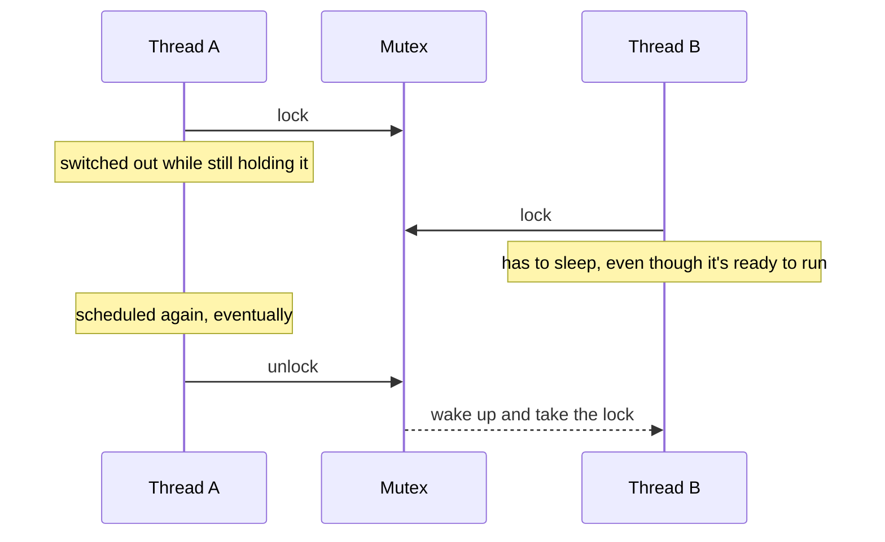

<big>Now every thread that needs the lock is waiting on one that isn't even running.</big>

<big>CAS has nothing to hold. A thread switched out mid-update can't block anyone, and if it lost the race, it just retries.</big>

It also means there's no lock ordering to get wrong, removing one source of deadlocks.

<br>
<br>
<br>
<br>
<br>
<br>
<br>
<br>

---

<br>
<br>
<br>
<br>
<br>
<br>
<br>
<br>

## How many threads?

Thread counts are hard to tune. Too few leave requests queued. Too many can compete for the GVL.
The right count changes with the workload.

[`atomic-ruby`](https://github.com/joshuay03/atomic-ruby)'s pool uses CRuby's thread-event API
to measure time holding the GVL, waiting for it, and blocked outside it, such as during I/O.

It combines those timings with CPU time to decide whether more threads would help.

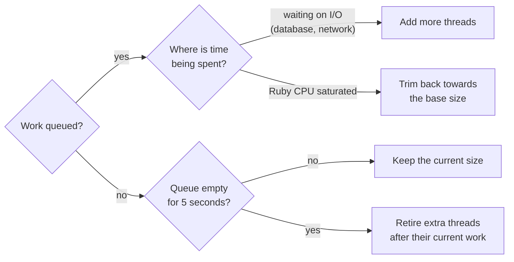

<big>It starts at `threads` (3 per worker by default) and adapts to the workload,
with no hard maximum. You don't have to choose one fixed thread count.</big>

<big>Set `max_threads` to fit your database pool or other resource limits, or match `threads` for a fixed pool.</big>

<br>
<br>
<br>
<br>
<br>
<br>
<br>
<br>

---

<br>
<br>
<br>
<br>
<br>
<br>
<br>
<br>

## The reactor

Slow clients, half-sent requests, and idle keep-alive connections aren't ready to be read yet. The reactor watches all of them at once.

<big>Like Puma, it uses [`nio4r`](https://github.com/socketry/nio4r), backed by `epoll` on Linux
and `kqueue` on macOS.</big>

<big>The HTTP/1.1 defaults are 30 seconds for the first bytes,
10 seconds between request chunks, and 65 seconds idle on keep-alive.</big>

As bytes arrive, deadlines move. The reactor needs to keep **thousands of them in order**.

<br>
<br>
<br>
<br>
<br>
<br>
<br>
<br>

---

<br>
<br>
<br>
<br>
<br>
<br>
<br>
<br>

## Keeping deadlines in order

**Puma** keeps an `Array` and sorts it after changes. Sorting is O(n log n), and removing a specific connection means scanning the whole list.

**Raptor** keeps a **red-black tree**, a binary search tree that rebalances itself as it changes.

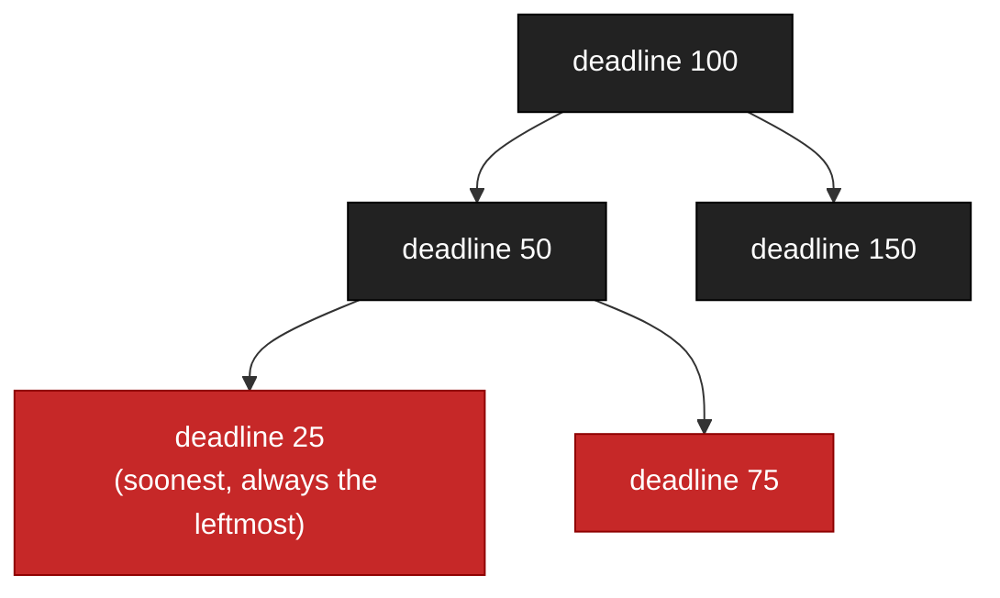

<big>Inserting and removing are O(log n). Finding the soonest deadline is O(1), because it's cached.</big>

The reactor removes expired deadlines from the front. Keeping this cheap matters with thousands of connections.

That one became another gem, **[`red-black-tree`](https://github.com/joshuay03/red-black-tree)**.

<br>
<br>
<br>
<br>
<br>
<br>
<br>
<br>

---

<br>
<br>
<br>
<br>
<br>
<br>
<br>
<br>

## Writing the response

Once your app returns, the response still has to become bytes on the socket.
Here's the common HTTP/1.1 path with an array body.

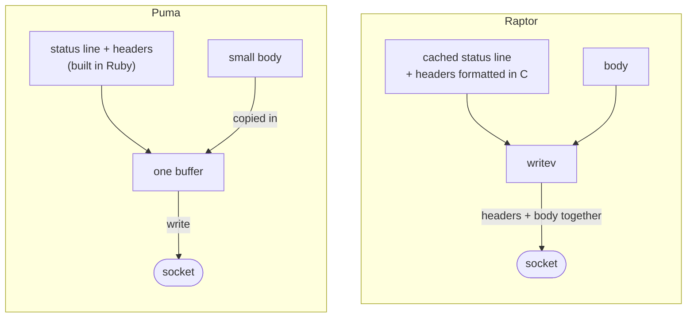

<big>Puma formats headers in Ruby and copies small bodies into the same buffer. It asks the OS to batch separate writes.</big>

<big>Raptor formats headers in C. `writev` sends headers and body without joining them into one string, in one syscall when possible.</big>
<br>
<br>
<br>
<br>
<br>
<br>
<br>
<br>

---

<br>
<br>
<br>
<br>
<br>
<br>
<br>
<br>

## HTTP/2 in one slide

HTTP/1.1 sends one request at a time on a connection. HTTP/2 sends many at once,
split into small binary frames.

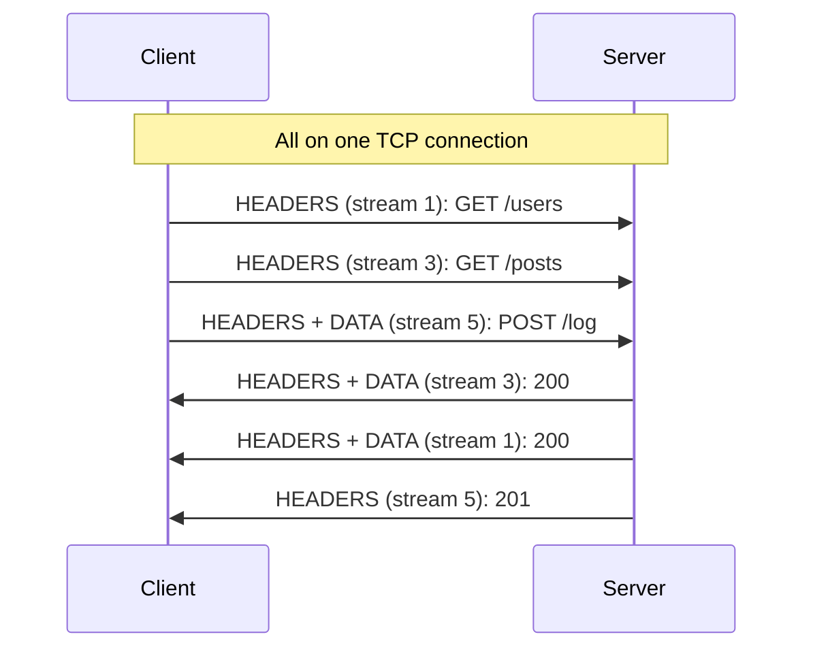

<big>**Multiplexing** lets many requests share one connection. **Header compression** reuses earlier headers. **Flow control** limits how much data each side can send.</big>

Raptor speaks HTTP/2 natively, and so does Falcon. Puma [leaves it to a proxy](https://github.com/puma/puma/issues/2697) like nginx.

<br>
<br>
<br>
<br>
<br>
<br>
<br>
<br>

---

<br>
<br>
<br>
<br>
<br>
<br>
<br>
<br>

## HTTP/2 in Raptor

<big>HTTP/2 gets its own C parser and Ractor pool. Each stream is its own job, so one connection can use several app threads.</big>

<big>For established connections, the reactor owns socket writes. App threads queue frames rather than competing to write to the same socket.</big>


<big>An ordinary response can still wait for HTTP/2 flow control. Long-lived streams need a way to release the app thread too.</big>

<br>
<br>
<br>
<br>
<br>
<br>
<br>
<br>

---

<br>
<br>
<br>
<br>
<br>
<br>
<br>
<br>

## Streams that outlive the request

SSE and gRPC responses can stay open for minutes. `Raptor::DetachedBody` lets them release the app thread.

```ruby
run ->(env) {
  body = Raptor::DetachedBody.new
  body.on_open { Subscribers.add(body) }
  body.on_close { Subscribers.remove(body) }
  [200, { "content-type" => "text/event-stream" }, body]
}
# Later, from any thread
Subscribers.each { |body| body.try_write("data: update\n\n") }
```

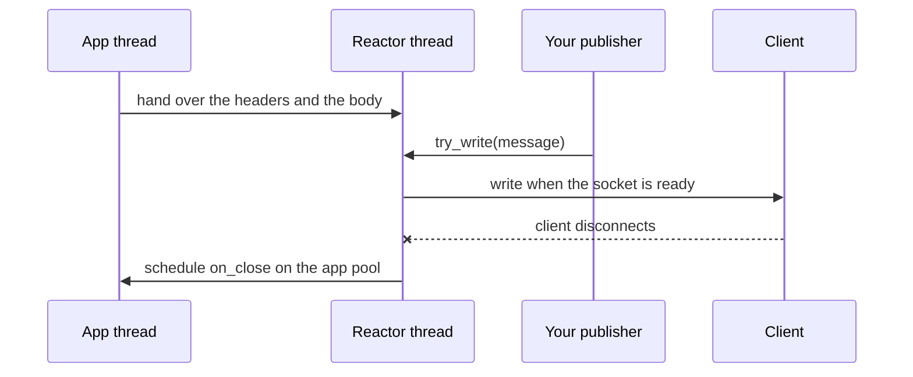

<big>`try_write` never waits for the client. It returns `:accepted`, `:full` (no buffer space), or `:closed`. Your publisher decides whether to retry or drop an update.</big>

Cleanup runs on the app pool via `on_close`. This works over HTTP/1.1 and HTTP/2.

<br>
<br>
<br>
<br>
<br>
<br>
<br>
<br>

---

<br>
<br>
<br>
<br>
<br>
<br>
<br>
<br>

## Enough HTTP/2 for gRPC

Raptor provides the HTTP/2 pieces for unary and server-streaming gRPC.
`DetachedBody` streams the response after the request body arrives in full.

```ruby
if body.try_write(encoded_message) == :accepted
  body.close(trailers: { "grpc-status" => "0" })
end # On :full, retry later rather than losing the message.
```

<big>**Trailers** carry gRPC's final status after the body. **Cancellation** closes abandoned streams, and **PINGs** help detect dead connections.</big>

<big>On shutdown, `GOAWAY` tells clients to stop opening streams while existing ones finish.</big>

<br>
<br>
<br>
<br>
<br>
<br>
<br>
<br>

---

<br>
<br>
<br>
<br>
<br>
<br>
<br>
<br>

## Zooming out to the processes

So far we've been inside one worker. Let's look at how the workers live together.

With **preforking**, the master loads your app once, then forks a copy for each worker.

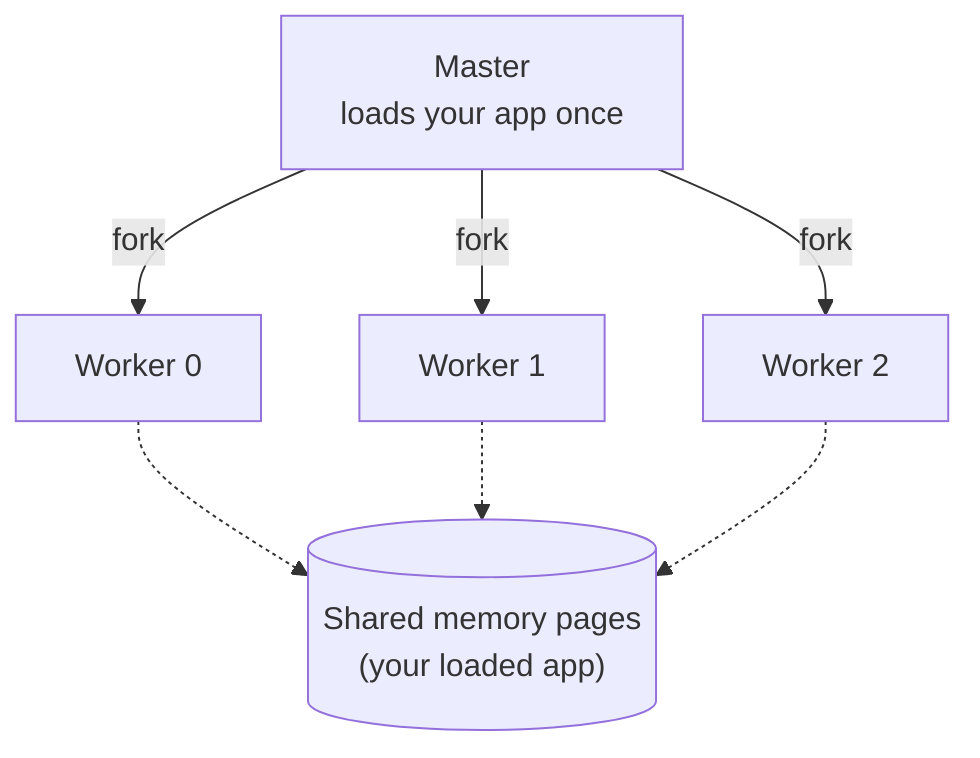

<big>Every worker starts out sharing the same memory, and a page is only copied when someone changes it. That's copy-on-write.</big>

<br>
<br>
<br>
<br>
<br>
<br>
<br>
<br>

---

<br>
<br>
<br>
<br>
<br>
<br>
<br>
<br>

## Refork

Copy-on-write savings fade as workers warm caches, compile YJIT code, and load gems lazily. Workers can lose much of that sharing as they warm up independently.

The fix is to fork replacement workers from a **warm** worker instead of the master.

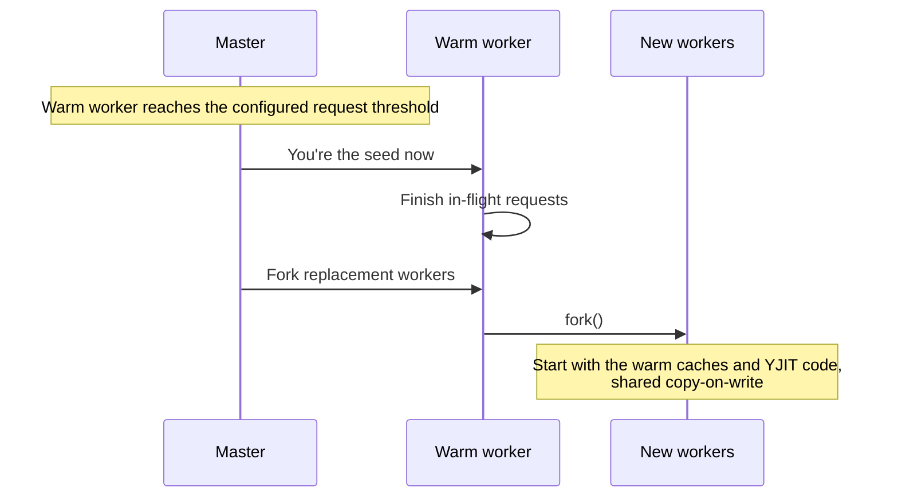

<big>The idea comes from Shopify's [Pitchfork](https://github.com/Shopify/pitchfork). Puma has experimental `fork_worker` support too.</big>

<big>I recently added [`mold_worker`](https://github.com/puma/puma/pull/4038) on Puma's main branch. Like Raptor's seed, the mold stops serving requests and only forks replacements.</big>

Raptor uses Linux's `PR_SET_CHILD_SUBREAPER` so the master can adopt workers it didn't fork.

<br>
<br>
<br>
<br>
<br>
<br>
<br>
<br>

---

<br>
<br>
<br>
<br>
<br>
<br>
<br>
<br>

## Shared memory for stats

The master needs to know how each worker is doing. Puma's workers report through pipes, while Raptor's write straight into shared memory.

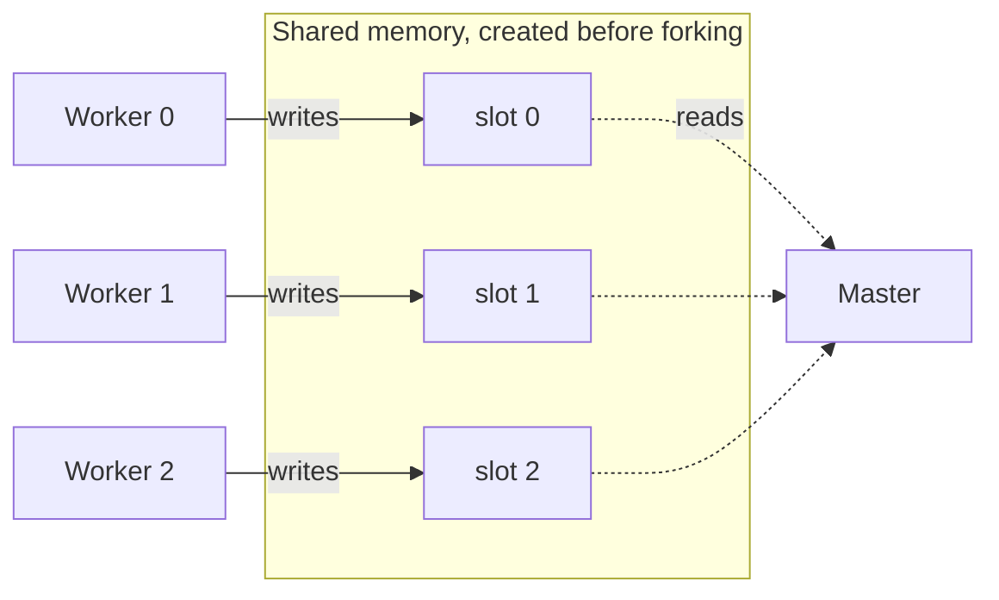

<big>The master creates the region with `mmap` before forking, so every worker inherits it. Each worker owns one 49-byte slot, so writes never clash.</big>

<big>Updating stats is a write to shared memory, with no pipe or syscall to send the update.</big>

That's where **[`mmap-ruby`](https://github.com/joshuay03/mmap-ruby)** came from.

<br>
<br>
<br>
<br>
<br>
<br>
<br>
<br>

---

<br>
<br>
<br>
<br>
<br>
<br>
<br>
<br>

## Which worker gets the next connection?

With Linux's `SO_REUSEPORT`, workers get separate listeners on the same port. The kernel hashes connection details to pick one, without knowing which workers are busy.

In Puma, busier workers pause briefly before accepting new connections. This gives less busy workers more chance to accept them.

On Linux, Raptor can use **BPF** to route plain TCP connections using real load.

<big>BPF lets you run tiny, kernel-verified programs inside Linux. It's the same technology behind `bpftrace` and Cilium.</big>

<br>
<br>
<br>
<br>
<br>
<br>
<br>
<br>

---

<br>
<br>
<br>
<br>
<br>
<br>
<br>
<br>

## Raptor's BPF program

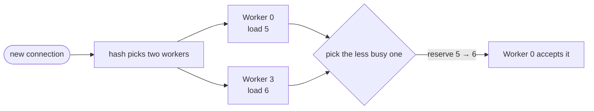

<big>A kernel-readable map tracks each worker's load, including pending connections.
The program compares two workers and picks the quieter one.</big>

<big>Checking every worker adds work to every connection. The "power of two choices"
helps avoid busy workers without scanning the whole cluster.</big>

It reserves the connection straight away, so the next arrival sees the updated load.

The program is about 70 lines of C, loaded through **[`libbpf-ruby`](https://github.com/joshuay03/libbpf-ruby)**.
Without the optional dependencies, Raptor uses normal listeners.

<br>
<br>
<br>
<br>
<br>
<br>
<br>
<br>

---

<br>
<br>
<br>
<br>
<br>
<br>
<br>
<br>

## Pinning workers to cores

Moving workers between cores can lose warm CPU caches.

<big>On Linux, `cpu_affinity` pins workers to cores when enough are available.
Puma doesn't have a built-in setting for this.</big>

<big>It's opt-in, because a pinned worker's threads and Ractors share one core.</big>

<br>
<br>
<br>
<br>
<br>
<br>
<br>
<br>

---

<br>
<br>
<br>
<br>
<br>
<br>
<br>
<br>

## The numbers over HTTP/1.1 without keep-alive

Scaling uses 3–16 threads per worker. Fixed uses 3. Falcon uses unbounded fibers.

**I/O-bound requests**

<big>With scaling threads, Raptor matches Puma on throughput and p95.
Falcon has 38% higher throughput than Raptor, with lower p95.
With 3 fixed threads, Raptor has over twice Puma's throughput.</big>

**CPU-bound requests**

<big>With scaling threads, Raptor gets about 23% more throughput than Puma, with 10% higher p95.
With 3 fixed threads, the throughput lead is 10%. Falcon leads on both metrics.</big>

<br>
<br>
<br>
<br>
<br>
<br>
<br>
<br>

---

<br>
<br>
<br>
<br>
<br>
<br>
<br>
<br>

## The numbers over HTTP/1.1 keep-alive

Scaling uses 3–16 threads per worker. Fixed uses 3. Falcon uses unbounded fibers.

**I/O-bound requests**

<big>With scaling threads, Raptor matches Puma and Falcon on throughput and p95.
With 3 fixed threads, Raptor has over twice Puma's throughput.</big>

**CPU-bound requests**

<big>With scaling threads, Raptor gets 7% more throughput and 20% lower p95 than scaling Puma.
With 3 fixed threads, Puma leads on both metrics.
Falcon has higher throughput, but Raptor's p95 is lower.</big>

<br>
<br>
<br>
<br>
<br>
<br>
<br>
<br>

---

<br>
<br>
<br>
<br>
<br>
<br>
<br>
<br>

## The numbers over HTTP/2

Raptor vs Falcon. Puma has no native HTTP/2.

**I/O-bound requests**

<big>With scaling threads, Raptor matches Falcon's throughput, with p95 around 30 ms versus 27 ms.
With 3 fixed threads, throughput is 78% lower than Falcon.</big>

**CPU-bound requests**

<big>With scaling threads, Raptor gets 21% more throughput than Falcon at about half the p95.
With 3 fixed threads, the throughput lead is 33%.</big>

Full results and the setup are in the [README](../README.md#micro-benchmarks).

<br>
<br>
<br>
<br>
<br>
<br>
<br>
<br>

---

<br>
<br>
<br>
<br>
<br>
<br>
<br>
<br>

## What you give up

<big>Raptor has less **battle-testing**. Puma has years of production Rails use. Raptor is less than a year old.</big>

<big>It needs **Ruby 4.0 or newer**. Ractors add overhead on 4.0 that I don't see in my 4.1 measurements.</big>

<big>**Debugging server internals** can involve tracing work across threads and Ractors.
Most app developers won't need to do that. Your app stays on ordinary threads.</big>

<br>
<br>
<br>
<br>
<br>
<br>
<br>
<br>

---

<br>
<br>
<br>
<br>
<br>
<br>
<br>
<br>

## Why it's worth being curious

I'd love you to try Raptor, but I also hope you leave curious about what's possible from Ruby now.

<big>Raptor combines Ractors, lock-free queues, shared memory, and BPF in one Rack server.</big>

<big>Let the pool adapt instead of choosing one fixed thread count.
Your app still runs on ordinary Rack threads.</big>

In these tests, scaling threads match Falcon's I/O throughput over keep-alive HTTP/1.1 and HTTP/2.

<big>Native HTTP/2 and detached streaming are there when you need them.</big>

Try your own workload to see how these pieces work together.

<br>
<br>
<br>
<br>
<br>
<br>
<br>
<br>

---

<br>
<br>
<br>
<br>
<br>
<br>
<br>
<br>

## Try it

```
bundle add raptor            # Ruby 4.0+
bundle exec raptor           # boots config.ru
bundle exec rails server -u raptor
```

<big>The CLI mirrors Puma's on purpose. Try it on your app.
Feedback and bug reports are very welcome.</big>

Test your real traffic, then try a small production canary with an easy way back to Puma.

For a detailed comparison of Raptor and Puma's designs, see [`docs/raptor-vs-puma.md`](raptor-vs-puma.md).

<br>
<br>
<br>
<br>
<br>
<br>
<br>
<br>

---

<br>
<br>
<br>
<br>
<br>
<br>
<br>
<br>

## Thanks

**Raptor**

[github.com/joshuay03/raptor](https://github.com/joshuay03/raptor)

**The gems that came out of it**

[`ractor-pool`](https://github.com/joshuay03/ractor-pool) provides Ractor workers.

[`atomic-ruby`](https://github.com/joshuay03/atomic-ruby) provides lock-free primitives and the thread pool.

[`red-black-tree`](https://github.com/joshuay03/red-black-tree) keeps deadlines in order.

[`mmap-ruby`](https://github.com/joshuay03/mmap-ruby) provides shared memory.

[`libbpf-ruby`](https://github.com/joshuay03/libbpf-ruby) loads BPF programs from Ruby.

_Questions?_
