# Raptor

## A Ruby 4 Web Server


_Joshua Young ([`@joshuay03`](https://github.com/joshuay03)) · Senior Software Engineer at [Buildkite](https://buildkite.com/)_

_On the [Rails](https://github.com/rails/rails), [Puma](https://github.com/puma/puma), and [Concurrent Ruby](https://github.com/ruby-concurrency/concurrent-ruby) maintainer teams_

_[BrisRails](https://luma.com/t3l24s8h) · August 2026_

_[Ruby Melbourne](https://www.meetup.com/ruby-melbourne/events/313408465/) · October 2026_

<br>
<br>
<br>
<br>
<br>
<br>
<br>
<br>

---

<br>
<br>
<br>
<br>
<br>
<br>
<br>
<br>

## Hi

<big>I'm Josh. By day I work on Buildkite's Rails monolith, and I also spend a lot of time in the internals of Puma and Rails.</big>

<big>Over the past year that turned into building my own Ruby web server, Raptor. It runs any Rack app, including Rails, the same way Puma and Falcon do. What makes it different is that it parses HTTP in parallel using Ractors, and it's fast enough that the numbers are interesting.</big>

<big>It's still young though, so I wouldn't put your production app behind it just yet.</big>

Today is a tour of what's inside it, and the parts of Ruby and Linux I had to learn along the way:

- <big>Ractors, and what changed in Ruby 4</big>
- <big>Lock-free data structures built on compare-and-swap</big>
- <big>Red-black trees</big>
- <big>Shared memory between processes</big>
- <big>Tiny programs that run inside the Linux kernel</big>

<br>
<br>
<br>
<br>
<br>
<br>
<br>
<br>

---

<br>
<br>
<br>
<br>
<br>
<br>
<br>
<br>

## What a web server actually does

Rails isn't a web server. [Rack](https://github.com/rack/rack) isn't one either. Rack is the contract between a web server and your app:

```ruby
# A complete Rack app. Nothing more is needed.
run ->(env) { [200, { "content-type" => "text/plain" }, ["hello\n"]] }
```

- <big>Your app is anything that responds to `#call`</big>
- <big>It takes a `Hash` describing the request (the "Rack env")</big>
- <big>It returns `[status, headers, body]`</big>

Everything else is the web server's job:

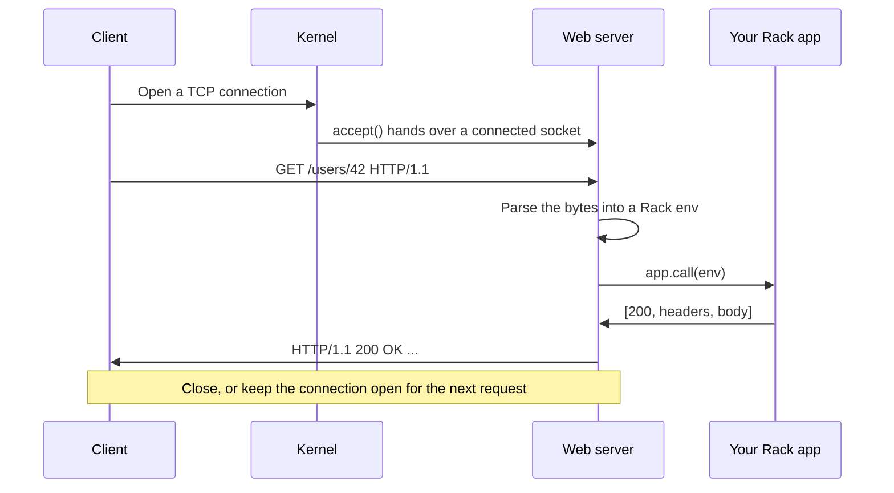

- <big>The kernel does the TCP handshake. The server just calls `accept` and gets a ready socket.</big>
- <big>The server reads bytes, parses them, calls your app, and writes the response back</big>
- <big>With keep-alive, the same connection carries the next request</big>

<br>
<br>
<br>
<br>
<br>
<br>
<br>
<br>

---

<br>
<br>
<br>
<br>
<br>
<br>
<br>
<br>

## The two servers you already know

**[Puma](https://github.com/puma/puma)**

<big>A few worker processes, each with a pool of threads. It only speaks HTTP/1.1, and it's battle-tested, which makes it the safe pick. It's also the one I know best, so I'll be comparing against it a lot today.</big>

**[Falcon](https://github.com/socketry/falcon)**

<big>Built by Samuel Williams on his [`async`](https://github.com/socketry/async) gem. Instead of a fixed pool of threads it uses fibers, which are lightweight coroutines that are much cheaper to create. It speaks HTTP/2, and it's excellent at long-lived connections and streaming.</big>

Both are great, but both were designed before Ractors were usable.

<br>
<br>
<br>
<br>
<br>
<br>
<br>
<br>

---

<br>
<br>
<br>
<br>
<br>
<br>
<br>
<br>

## The Ruby 4 opening

<big>Ractors have been around since Ruby 3.0, but the API kept changing, so most of us never touched them.</big>

<big>Ruby 4, which shipped last Christmas, reworked them around `Ractor::Port`, a channel that many Ractors can send to and one can receive from. That's exactly the shape you need for "many workers, one collector". They're still marked experimental, but the core team is working towards dropping that label.</big>

That got me wondering:

> What would a Ruby web server look like if it was built around Ractors from the start?

<br>
<br>
<br>
<br>
<br>
<br>
<br>
<br>

---

<br>
<br>
<br>
<br>
<br>
<br>
<br>
<br>

## Ractors in one slide

Ruby has a Global VM Lock (GVL). Only one thread at a time can run Ruby code.

A Ractor is an isolated area of Ruby with **its own GVL**. Two Ractors can run Ruby code on two CPU cores at the same instant. That's real parallelism, not just taking turns.

The catch is isolation. A Ractor can't reach into its surroundings:

```ruby
data = { name: "hello" }

Ractor.new { puts data }
# ArgumentError: can not isolate a Proc because it accesses outer variables (data).
```

Instead, Ractors pass messages:

```ruby
port = Ractor::Port.new

worker = Ractor.new(port) do |port|
  loop { port.send("processed: #{Ractor.receive}") }
end

worker.send("hello")
port.receive # => "processed: hello"
```

- <big>Frozen values are shared as is</big>
- <big>Mutable values are deep-copied, or moved with `move: true` so the sender can't touch them again</big>
- <big>No shared mutable state means no data races</big>

<br>
<br>
<br>
<br>
<br>
<br>
<br>
<br>

---

<br>
<br>
<br>
<br>
<br>
<br>
<br>
<br>

## What Ractors are good for

They won't make your app parallel on their own, because almost no gem you use is Ractor-safe. Where they do help is work that is:

- <big>Small and CPU-heavy</big>
- <big>Free of global state</big>
- <big>Free of gem dependencies</big>
- <big>Easy to hand off: bytes in, result out</big>

That describes HTTP parsing exactly.

<br>
<br>
<br>
<br>
<br>
<br>
<br>
<br>

---

<br>
<br>
<br>
<br>
<br>
<br>
<br>
<br>

## The idea

Puma parses each request on the same thread that's about to run your app. Parsing and your app take turns on the same GVL.

If parsing runs in a Ractor instead, it gets its own GVL:

```mermaid
gantt
    title One worker process, over time
    dateFormat x
    axisFormat %L ms

    section Puma (one GVL)
    Parse request A     :0, 2
    App handles A       :2, 8
    Parse request B     :8, 10
    App handles B       :10, 16

    section Raptor (app GVL)
    App handles A       :2, 8
    App handles B       :8, 14

    section Raptor (parser Ractor GVL)
    Parse request A     :0, 2
    Parse request B     :2, 4
```

<big>While your app handles request A, a Ractor is already parsing request B, so parsing stops stealing time from your app. Your app still runs on normal threads, which means it doesn't need to be Ractor-safe.</big>

If a whole request arrives in one read, Raptor skips the Ractor and parses it straight away. The Ractor pipeline is for connections that need to wait for more bytes.

<br>
<br>
<br>
<br>
<br>
<br>
<br>
<br>

---

<br>
<br>
<br>
<br>
<br>
<br>
<br>
<br>

## Raptor at a glance

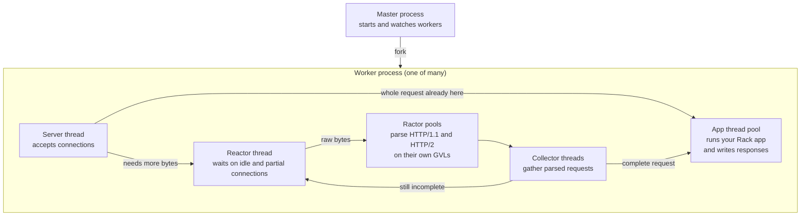

Let's walk through each piece.

<br>
<br>
<br>
<br>
<br>
<br>
<br>
<br>

---

<br>
<br>
<br>
<br>
<br>
<br>
<br>
<br>

## The Ractor pools

Each protocol gets its own pool of parser Ractors. A coordinator hands work to whichever parser is free.

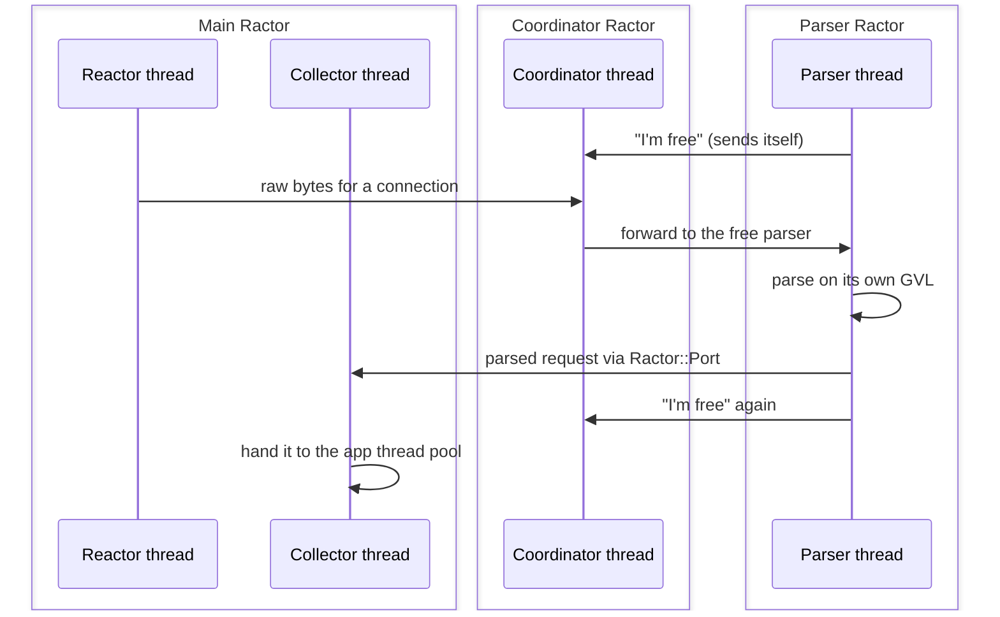

<big>Idle parsers send **themselves** back to the coordinator, so it always knows who's free without polling or busy-waiting.</big>

<big>The parsers themselves are C extensions marked Ractor-safe, so they can run in any Ractor. Common header names (`HTTP_HOST`, `HTTP_ACCEPT`, and 37 more) are created once and reused, so each request allocates less.</big>

I pulled this pattern out into its own gem, **[`ractor-pool`](https://github.com/joshuay03/ractor-pool)**.

<br>
<br>
<br>
<br>
<br>
<br>
<br>
<br>

---

<br>
<br>
<br>
<br>
<br>
<br>
<br>
<br>

## The app thread pool

This is where your Rack app runs.

Puma's pool is a queue guarded by a `Mutex`. Every time a thread adds or takes work, it takes the lock. When things get busy, threads line up behind it.

Raptor's pool has **no locks** at all. To explain how, we need one tiny CPU instruction.

<br>
<br>
<br>
<br>
<br>
<br>
<br>
<br>

---

<br>
<br>
<br>
<br>
<br>
<br>
<br>
<br>

## Compare-and-swap (CAS)

"Set this value to **new**, but only if it's still **expected**." The CPU does it as one indivisible step.

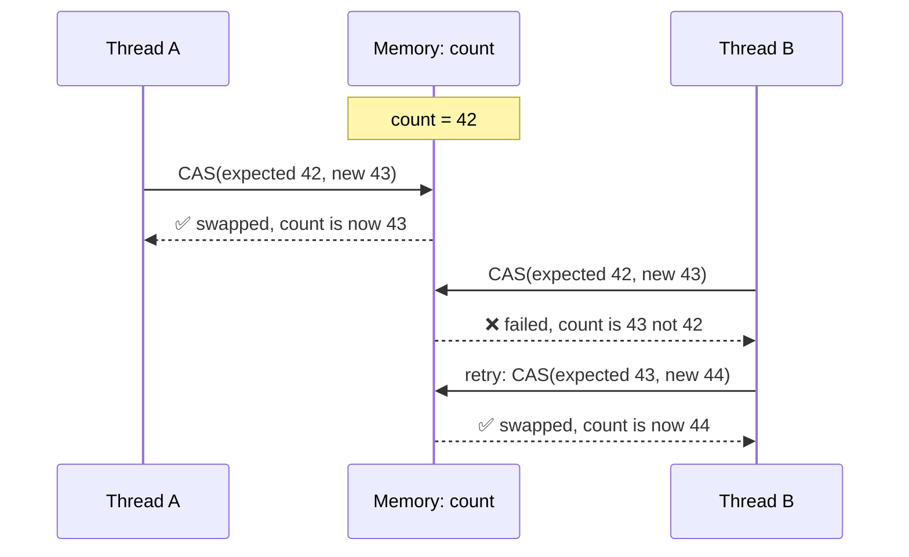

<big>Nobody waits on a lock. The loser just retries with the fresh value.</big>

<big>The catch is that it only works on one value at a time, like a single number or pointer. So it suits small, focused updates such as a counter, a flag, or the head of a queue.</big>

A mutex is still the simpler tool for bigger critical sections. CAS is worth it on hot paths, where every thread would otherwise be queuing for the same lock.

I wrote a native gem that brings these primitives to Ruby, **[`atomic-ruby`](https://github.com/joshuay03/atomic-ruby)**.

<br>
<br>
<br>
<br>
<br>
<br>
<br>
<br>

---

<br>
<br>
<br>
<br>
<br>
<br>
<br>
<br>

## A queue with no lock

Raptor's work queue is [`atomic-ruby`](https://github.com/joshuay03/atomic-ruby)'s `AtomicQueue`, a lock-free linked list (the classic Michael-Scott queue). Producers add at the tail, consumers take from the head, and each step is a single CAS.

**Adding work C**


**Taking work**


<big>Adding and taking never block each other. If two threads race, one CAS wins and the other retries. The server thread also checks the queue size on every accept, and that doesn't need a lock either.</big>

<br>
<br>
<br>
<br>
<br>
<br>
<br>
<br>

---

<br>
<br>
<br>
<br>
<br>
<br>
<br>
<br>

## No mutexes at all

There isn't a single `Mutex` in Raptor's own code. Shared state is either owned by one thread, passed along as a message, or updated with CAS.

That's not only about speed. Under the GVL, a thread can be switched out at almost any point, including while it's holding a lock:

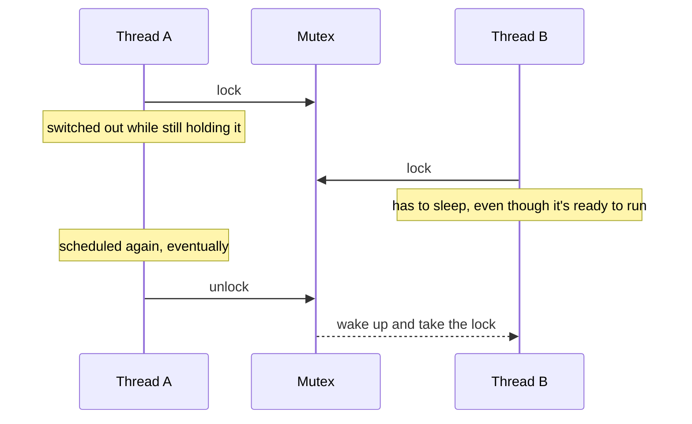

<big>Every thread that needs that lock now waits on a thread that isn't even running. Under load, that's how a short critical section turns into a queue.</big>

<big>CAS can't leave anyone in that position, because there's nothing to hold. If a thread is switched out halfway through an update, the others carry on, and if they changed the value in the meantime, its CAS just fails and it retries.</big>

It also means there's no lock ordering to get wrong, which is where deadlocks come from.

<br>
<br>
<br>
<br>
<br>
<br>
<br>
<br>

---

<br>
<br>
<br>
<br>
<br>
<br>
<br>
<br>

## How many threads?

Most Rails requests spend their time waiting on the database or the network. While a thread waits, it gives up the GVL, so more threads means more requests in flight. But if your app is busy running Ruby, more threads just means more waiting for the GVL.

Raptor uses [`atomic-ruby`](https://github.com/joshuay03/atomic-ruby)'s `AtomicThreadPool`, which watches what its threads are actually doing through a CRuby hook that reports when each one runs, waits, or blocks:

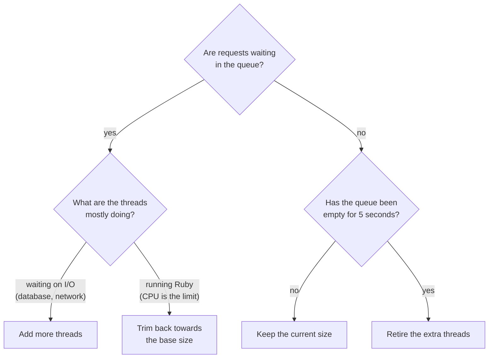

<big>Each worker starts with `threads` (3 by default) and only grows while requests are queued and its threads are mostly waiting on I/O. Set `max_threads` to cap the growth, or set it to `threads` for a fixed pool.</big>

<br>
<br>
<br>
<br>
<br>
<br>
<br>
<br>

---

<br>
<br>
<br>
<br>
<br>
<br>
<br>
<br>

## The reactor

Some connections aren't ready to be read yet: slow clients, half-sent requests, idle keep-alive connections. The reactor watches all of them at once.

- <big>It uses [`nio4r`](https://github.com/socketry/nio4r), which wraps the operating system's "watch many sockets" API (`epoll` on Linux, `kqueue` on macOS). Puma uses it too.</big>
- <big>Every connection also has a deadline:</big>
  - 30s to send the first bytes
  - 10s between chunks of a request
  - 65s idle between keep-alive requests

Deadlines change constantly, because every time a connection sends bytes its deadline moves. So the reactor needs a cheap way to keep **thousands of deadlines in order**.

<br>
<br>
<br>
<br>
<br>
<br>
<br>
<br>

---

<br>
<br>
<br>
<br>
<br>
<br>
<br>
<br>

## Keeping deadlines in order

**Puma** keeps an `Array` and sorts it after changes. Sorting is O(n log n), and removing a specific connection means scanning the whole list.

**Raptor** keeps a **red-black tree**: a binary search tree that rebalances itself as it changes.

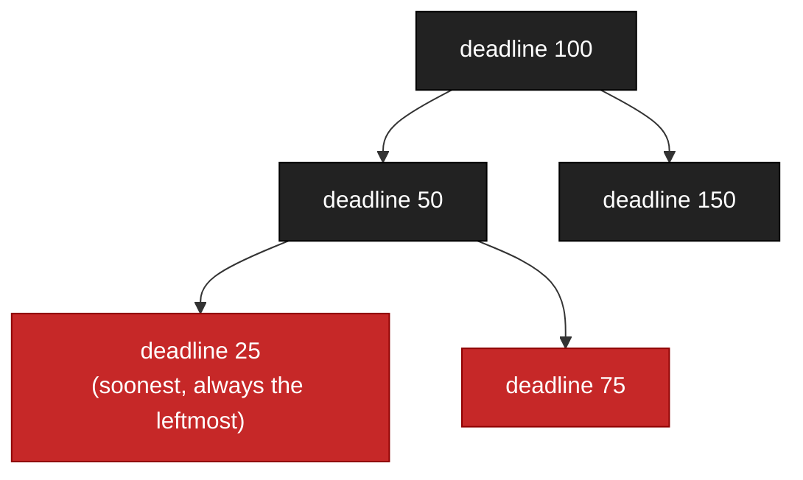

<big>Inserting, removing, and finding the soonest deadline are all O(log n). When a connection sends bytes, Raptor removes its old deadline and inserts the new one. To expire connections, it walks from the leftmost node and stops at the first one that isn't due yet.</big>

With a hundred connections you wouldn't notice the difference, but it adds up once you have thousands.

That one became another gem, **[`red-black-tree`](https://github.com/joshuay03/red-black-tree)**.

<br>
<br>
<br>
<br>
<br>
<br>
<br>
<br>

---

<br>
<br>
<br>
<br>
<br>
<br>
<br>
<br>

## Writing the response

Once your app returns, the response still has to become bytes on the socket.


<big>Puma builds the response in Ruby. It copies small bodies into its header buffer so it can send a single write, and for larger ones it writes twice and corks the socket, so the kernel waits for the rest before sending.</big>

<big>Raptor builds the status line, headers, and chunked encoding in C, into a buffer each thread reuses across requests. It then sends everything with a single `writev` call, which takes a list of strings and writes them in one syscall. So the headers and your body go out together, without first being copied into one big string.</big>
<br>
<br>
<br>
<br>
<br>
<br>
<br>
<br>

---

<br>
<br>
<br>
<br>
<br>
<br>
<br>
<br>

## HTTP/2 in one slide

HTTP/1.1 sends one request at a time on a connection. HTTP/2 sends many at once, split into small binary frames:

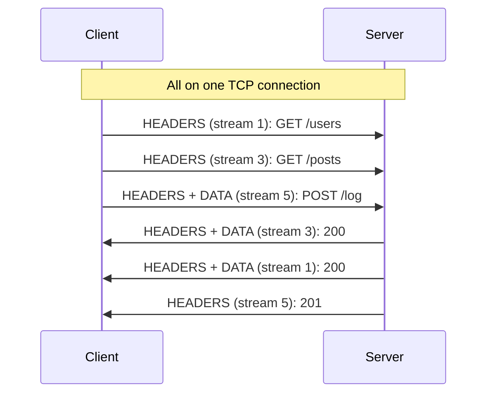

- <big>**Multiplexing**: many requests (streams) share one connection</big>
- <big>**Header compression** (HPACK): headers you've already sent become tiny numbers</big>
- <big>**Flow control**: each side says how much data it's ready to receive</big>

Raptor speaks HTTP/2 natively, over TLS or cleartext. Puma [leaves it to a proxy](https://github.com/puma/puma/issues/2697) in front, like nginx. Falcon speaks it too.

<br>
<br>
<br>
<br>
<br>
<br>
<br>
<br>

---

<br>
<br>
<br>
<br>
<br>
<br>
<br>
<br>

## HTTP/2 in Raptor

<big>HTTP/2 gets its own Ractor-safe C parser and its own Ractor pool. Each stream becomes a separate job for the app thread pool, so one connection can use several app threads at once.</big>

<big>Only the reactor ever writes to the socket. App threads hand it frames and carry on.</big>

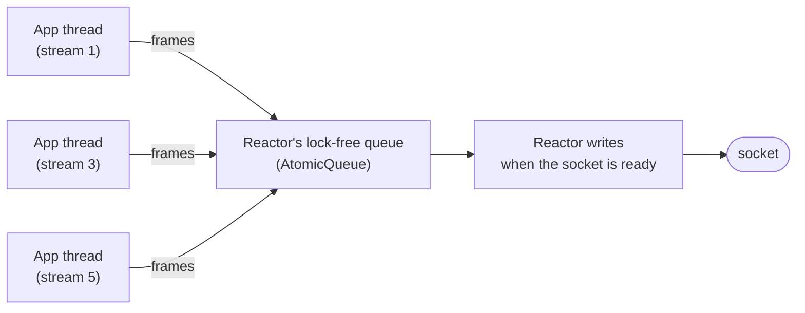

<big>No thread ever waits for a slow client to read, and there's no lock around the socket because only one thread owns it.</big>

<br>
<br>
<br>
<br>
<br>
<br>
<br>
<br>

---

<br>
<br>
<br>
<br>
<br>
<br>
<br>
<br>

## Streams that outlive the request

Some responses stay open for minutes: server-sent events, live updates, gRPC streams. Normally each one holds an app thread the whole time. A thousand open streams means a thousand busy threads doing nothing.

Raptor's answer is `Raptor::DetachedBody`:

```ruby
run ->(env) {
  body = Raptor::DetachedBody.new
  body.on_open { Subscribers.add(body) }
  body.on_close { Subscribers.remove(body) }
  [200, { "content-type" => "text/event-stream" }, body]
}

# Later, from any thread
Subscribers.each { |body| body.try_write("data: update\n\n") }
```

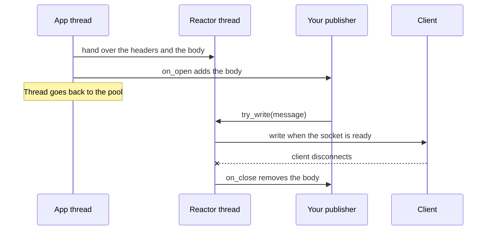

<big>The app thread returns straight away and the reactor owns the stream from then on. `try_write` never blocks. It just returns `:accepted`, `:full`, or `:closed`.</big>

<big>When the client disconnects or the server shuts down, `on_close` runs immediately. It works over both HTTP/1.1 and HTTP/2.</big>

When I first tried this in an app at work, every new HTTP/2 stream still held an app thread for about 1.5ms. The handoff to the reactor was polling while it waited, so I changed it to wake the thread up instead.

<br>
<br>
<br>
<br>
<br>
<br>
<br>
<br>

---

<br>
<br>
<br>
<br>
<br>
<br>
<br>
<br>

## Enough HTTP/2 for gRPC

gRPC runs over HTTP/2, and it relies on a few parts of the protocol most web apps never touch. Raptor supports them, so a `DetachedBody` can serve a gRPC stream:

```ruby
body.try_write(encoded_message)
body.close(trailers: { "grpc-status" => "0" })
```

- <big>**Trailers**: headers sent after the body. gRPC puts its final status there, because it isn't known until the stream ends.</big>
- <big>**Cancellation**: when a client gives up on a stream, Raptor passes that on to your body straight away</big>
- <big>**Keepalive PINGs**: idle connections get pinged, so dead ones are noticed and closed</big>
- <big>**Graceful shutdown**: `GOAWAY` tells clients to stop opening new streams while the current ones finish</big>

<br>
<br>
<br>
<br>
<br>
<br>
<br>
<br>

---

<br>
<br>
<br>
<br>
<br>
<br>
<br>
<br>

## Zooming out: the processes

So far we've been inside one worker. Let's look at how the workers live together.

**Preforking**: the master loads your app once, then forks a copy for each worker.

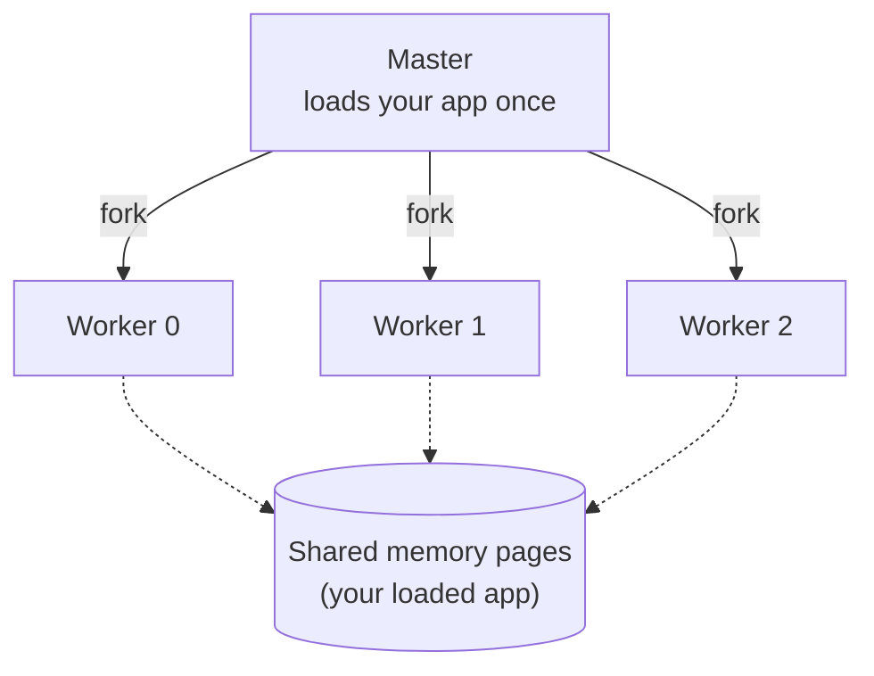

<big>After a fork, every worker points at the same physical memory, and a page is only copied when someone changes it. That's called copy-on-write, and it's why ten workers don't cost ten copies of your app.</big>

<br>
<br>
<br>
<br>
<br>
<br>
<br>
<br>

---

<br>
<br>
<br>
<br>
<br>
<br>
<br>
<br>

## Refork

Copy-on-write savings fade. As workers serve traffic, they change pages: caches warm up, YJIT compiles code, gems load lazily. After a few hours, every worker has its own copy of most pages.

The fix: periodically fork new workers from a **warm** worker instead of the master.

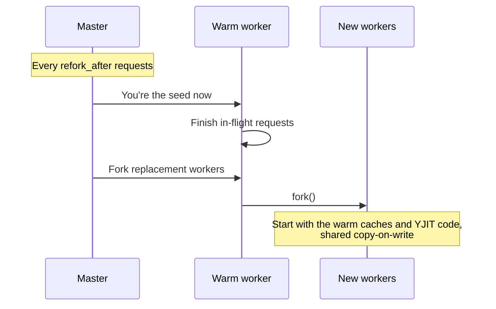

<big>The idea comes from Shopify's [Pitchfork](https://github.com/Shopify/pitchfork). Puma has an experimental version of it too, `fork_worker`, and a handful of my Puma PRs have been fixing bugs in it.</big>

<big>One Linux trick makes it work. `PR_SET_CHILD_SUBREAPER` lets the master adopt workers it didn't fork itself. That makes it Linux only, so on macOS `refork_after` is ignored with a warning.</big>

<br>
<br>
<br>
<br>
<br>
<br>
<br>
<br>

---

<br>
<br>
<br>
<br>
<br>
<br>
<br>
<br>

## Shared memory for stats

The master needs to know how each worker is doing. Puma's workers send status messages through pipes. Raptor's workers write straight into memory the master can read.

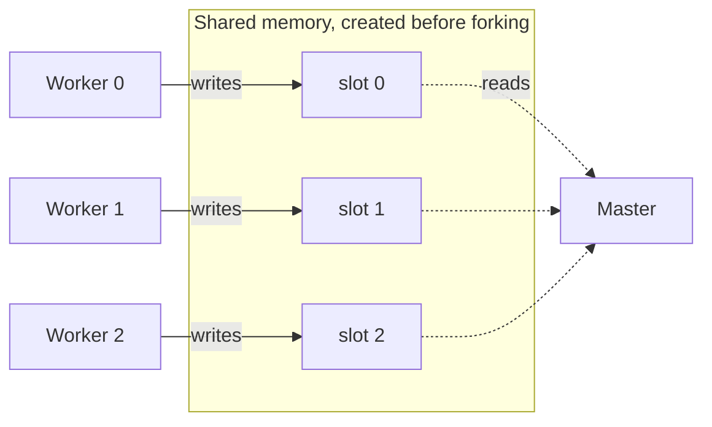

<big>The master creates the region with `mmap` before forking, so every worker inherits it. Each worker then writes its own 49-byte slot (requests, backlog, busy threads, and when it last checked in), and because each slot has exactly one writer, writes never clash.</big>

<big>So there's no pipe to read and no text to parse, and updating stats is just a write to memory, without a syscall.</big>

That's where **[`mmap-ruby`](https://github.com/joshuay03/mmap-ruby)** came from.

<br>
<br>
<br>
<br>
<br>
<br>
<br>
<br>

---

<br>
<br>
<br>
<br>
<br>
<br>
<br>
<br>

## Which worker gets the next connection?

All workers listen on the same port. By default, Linux picks a worker by hashing the client's address. That spreads connections evenly **on average**, but it can't see that worker 2 is drowning while worker 3 is idle.

Puma nudges the odds. Busier workers pause briefly before accepting, so quieter ones tend to win.

Raptor lets the kernel decide using real load, with **BPF**.

<big>BPF lets you run tiny programs inside the Linux kernel. The kernel checks each program is safe before running it (no unbounded loops, no bad memory access), and it's the same technology that powers tools like `bpftrace` and Cilium.</big>

<br>
<br>
<br>
<br>
<br>
<br>
<br>
<br>

---

<br>
<br>
<br>
<br>
<br>
<br>
<br>
<br>

## Raptor's BPF program


<big>Each worker publishes how busy it is to a map the kernel can read. For each new connection, the program compares two workers and picks the quieter one, which is known as "power of two choices". It bumps that worker's count straight away, so a burst of connections doesn't all pile onto the same worker.</big>

<big>The whole program is under 60 lines of C. If BPF isn't available, Raptor quietly falls back to the default behaviour.</big>

To load it from Ruby, I wrote **[`libbpf-ruby`](https://github.com/joshuay03/libbpf-ruby)**.

<br>
<br>
<br>
<br>
<br>
<br>
<br>
<br>

---

<br>
<br>
<br>
<br>
<br>
<br>
<br>
<br>

## Pinning workers to cores

Linux is free to move a process between CPU cores whenever it likes. Each move lands the worker on a core with cold caches, so it spends time fetching memory it already had close by.

<big>With `cpu_affinity` on, each worker pins itself to its own core when it boots, so it stays where its caches are warm. Puma doesn't have an option for this.</big>

<big>It's off by default because it's a trade-off. A pinned worker's app threads and parser Ractors all share that one core, so it only kicks in when there's a core for every worker, and it suits machines that only run Raptor. I've seen it help in my own testing, but I don't have numbers to show you yet.</big>

<br>
<br>
<br>
<br>
<br>
<br>
<br>
<br>

---

<br>
<br>
<br>
<br>
<br>
<br>
<br>
<br>

## The numbers

Full results are in the [README](../README.md#micro-benchmarks). Two workloads: **I/O** (requests that mostly wait on fake database calls) and **CPU** (requests that mostly run Ruby). Every server gets 10 worker processes and 120 requests in flight at a time, and each number is the median of three runs.

- <big>**I/O-heavy HTTP/1.1**: when Raptor can add threads, it handles 4.5 to 5.5 times Puma's throughput, with far lower tail latency</big>
- <big>**CPU-heavy HTTP/1.1**: Raptor is 10 to 23% behind Puma. Extra threads can't help when Ruby itself is the bottleneck.</big>
- <big>**HTTP/2**: Raptor beats Falcon on I/O throughput by about 40%, and has the lower tail latency on CPU</big>
- <big>**Falcon**: it still wins I/O-heavy HTTP/1.1 without keep-alive. Fibers are very good at waiting.</big>

So which server comes out ahead depends on the workload. These are micro benchmarks though, so I wouldn't read too much into the exact numbers.

<br>
<br>
<br>
<br>
<br>
<br>
<br>
<br>

---

<br>
<br>
<br>
<br>
<br>
<br>
<br>
<br>

## What you give up

- <big>**Battle-testing**: Puma has run production Rails since 2011. Raptor is less than a year old.</big>
- <big>**Older Rubies**: Raptor needs Ruby 4.0.</big>
- <big>**Easy debugging**: a request can cross threads and Ractors, so tracing it means stitching stack traces together.</big>

<br>
<br>
<br>
<br>
<br>
<br>
<br>
<br>

---

<br>
<br>
<br>
<br>
<br>
<br>
<br>
<br>

## Why it's worth being curious

I'm not asking you to swap your production server tomorrow. What I'd like you to take away is that a lot more is possible from Ruby than it used to be:

- <big>Ractors are finally practical</big>
- <big>We can build lock-free data structures in Ruby</big>
- <big>We can share memory between processes with `mmap`</big>
- <big>We can load BPF programs into the kernel from Ruby</big>

None of these ideas are new on their own. What's new is that we can combine them in one Ruby server, and see how far that gets us.

<br>
<br>
<br>
<br>
<br>
<br>
<br>
<br>

---

<br>
<br>
<br>
<br>
<br>
<br>
<br>
<br>

## Try it

```
gem install raptor           # Ruby 4.0+
bundle exec raptor           # boots config.ru
bundle exec rails server -u raptor
```

- <big>The CLI mirrors Puma's on purpose</big>
- <big>Feedback and bug reports very welcome</big>

The long version of this talk, with much more detail, is [`docs/raptor-vs-puma.md`](raptor-vs-puma.md).

<br>
<br>
<br>
<br>
<br>
<br>
<br>
<br>

---

<br>
<br>
<br>
<br>
<br>
<br>
<br>
<br>

## Thanks

**Raptor**

[github.com/joshuay03/raptor](https://github.com/joshuay03/raptor)

**The gems that came out of it**

- <big>[`ractor-pool`](https://github.com/joshuay03/ractor-pool): a pool of Ractor workers</big>
- <big>[`atomic-ruby`](https://github.com/joshuay03/atomic-ruby): lock-free primitives and the thread pool</big>
- <big>[`red-black-tree`](https://github.com/joshuay03/red-black-tree): a self-balancing tree</big>
- <big>[`mmap-ruby`](https://github.com/joshuay03/mmap-ruby): shared memory</big>
- <big>[`libbpf-ruby`](https://github.com/joshuay03/libbpf-ruby): BPF from Ruby</big>

_Questions?_
