# Raptor

## A Ruby 4 Web Server


_Joshua Young ([`@joshuay03`](https://github.com/joshuay03)) · Senior Software Engineer at [Buildkite](https://buildkite.com/)_

_On the [Rails](https://github.com/rails/rails), [Puma](https://github.com/puma/puma), and [Concurrent Ruby](https://github.com/ruby-concurrency/concurrent-ruby) maintainer teams_

_[BrisRails](https://luma.com/t3l24s8h) · August 2026_

_[Ruby Melbourne](https://www.meetup.com/ruby-melbourne/events/313408465/) · October 2026_

<br>
<br>
<br>
<br>
<br>
<br>
<br>
<br>

---

<br>
<br>
<br>
<br>
<br>
<br>
<br>
<br>

## Hi

<big>I'm Josh. By day I work on Buildkite's Rails monolith, and I also spend a lot of time in the internals of Puma and Rails.</big>

<big>Over the past year that turned into my own Ruby web server, Raptor. It runs any Rack app, Rails included, and parses HTTP in parallel using Ractors.</big>

<big>It's still young though, so I wouldn't put your production app behind it just yet.</big>

Today is a tour of what's inside it, and the parts of Ruby and Linux I had to learn along the way:

- <big>Ractors, and what changed in Ruby 4</big>
- <big>Lock-free data structures built on compare-and-swap</big>
- <big>Red-black trees</big>
- <big>Shared memory between processes</big>
- <big>Tiny programs that run inside the Linux kernel</big>

<br>
<br>
<br>
<br>
<br>
<br>
<br>
<br>

---

<br>
<br>
<br>
<br>
<br>
<br>
<br>
<br>

## What a web server actually does

Rails isn't a web server. [Rack](https://github.com/rack/rack) isn't one either. Rack is the contract between a web server and your app:

```ruby
# A complete Rack app. Nothing more is needed.
run ->(env) { [200, { "content-type" => "text/plain" }, ["hello\n"]] }
```

- <big>Your app is anything that responds to `#call`</big>
- <big>It takes a `Hash` describing the request (the "Rack env")</big>
- <big>It returns `[status, headers, body]`</big>

Everything else is the web server's job:

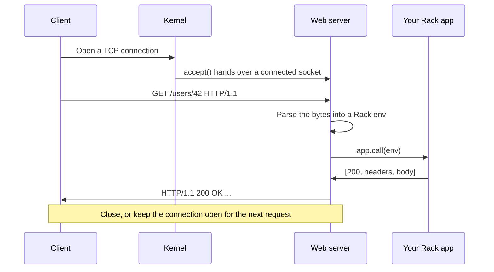

- <big>The kernel does the TCP handshake. The server just calls `accept` and gets a ready socket.</big>
- <big>The server reads bytes, parses them, calls your app, and writes the response back</big>
- <big>With keep-alive, the same connection carries the next request</big>

<br>
<br>
<br>
<br>
<br>
<br>
<br>
<br>

---

<br>
<br>
<br>
<br>
<br>
<br>
<br>
<br>

## The two servers you already know

**[Puma](https://github.com/puma/puma)**

<big>Worker processes, each with a pool of threads. It's HTTP/1.1 only, battle-tested, and the one I know best.</big>

**[Falcon](https://github.com/socketry/falcon)**

<big>Built by Samuel Williams on his [`async`](https://github.com/socketry/async) gem. It uses fibers instead of a thread pool, speaks HTTP/2, and is great at streaming.</big>

Both are great, but both were designed before Ractors were usable.

<br>
<br>
<br>
<br>
<br>
<br>
<br>
<br>

---

<br>
<br>
<br>
<br>
<br>
<br>
<br>
<br>

## The Ruby 4 opening

<big>Ractors have been around since Ruby 3.0, but the API kept changing, so most of us never touched them.</big>

<big>Ruby 4 reworked them around `Ractor::Port`, which many Ractors can send to and one can receive from. That's exactly the shape of "many workers, one collector".</big>

<big>They're still marked experimental, but Ruby 4.1 moves them closer to dropping that label. For one, each Ractor will collect its own garbage without stopping the others.</big>

That got me wondering:

> What would a Ruby web server look like if it was built around Ractors from the start?

<br>
<br>
<br>
<br>
<br>
<br>
<br>
<br>

---

<br>
<br>
<br>
<br>
<br>
<br>
<br>
<br>

## Ractors in one slide

Ruby has a Global VM Lock (GVL). Only one thread at a time can run Ruby code.

A Ractor is an isolated area of Ruby with **its own GVL**, so two Ractors can run Ruby on two cores at the same time.

The catch is isolation. A Ractor can't reach into its surroundings:

```ruby
data = { name: "hello" }

Ractor.new { puts data }
# ArgumentError: can not isolate a Proc because it accesses outer variables (data).
```

Instead, Ractors pass messages:

```ruby
port = Ractor::Port.new

worker = Ractor.new(port) do |port|
  loop { port.send("processed: #{Ractor.receive}") }
end

worker.send("hello")
port.receive # => "processed: hello"
```

- <big>Frozen values are shared as is</big>
- <big>Mutable values are deep-copied, or moved with `move: true` so the sender can't touch them again</big>
- <big>No shared mutable state means no data races</big>

<br>
<br>
<br>
<br>
<br>
<br>
<br>
<br>

---

<br>
<br>
<br>
<br>
<br>
<br>
<br>
<br>

## What Ractors are good for

They won't make your app parallel on their own, because almost no gem you use is Ractor-safe. Where they do help is work that is:

- <big>Small and CPU-heavy</big>
- <big>Free of global state</big>
- <big>Free of gem dependencies</big>
- <big>Easy to hand off: bytes in, result out</big>

That describes HTTP parsing exactly.

<br>
<br>
<br>
<br>
<br>
<br>
<br>
<br>

---

<br>
<br>
<br>
<br>
<br>
<br>
<br>
<br>

## The idea

Puma parses each request on the same thread that's about to run your app. Parsing and your app take turns on the same GVL.

If parsing runs in a Ractor instead, it gets its own GVL:

```mermaid
gantt
    title One worker process, over time
    dateFormat x
    axisFormat %L ms

    section Puma (one GVL)
    Parse request A     :0, 2
    App handles A       :2, 8
    Parse request B     :8, 10
    App handles B       :10, 16

    section Raptor (app GVL)
    App handles A       :2, 8
    App handles B       :8, 14

    section Raptor (parser Ractor GVL)
    Parse request A     :0, 2
    Parse request B     :2, 4
```

<big>While your app handles request A, a Ractor is already parsing request B. Your app stays on normal threads, so it doesn't need to be Ractor-safe.</big>

If a whole request arrives in one read, Raptor skips the Ractor and parses it straight away.

<br>
<br>
<br>
<br>
<br>
<br>
<br>
<br>

---

<br>
<br>
<br>
<br>
<br>
<br>
<br>
<br>

## Raptor at a glance

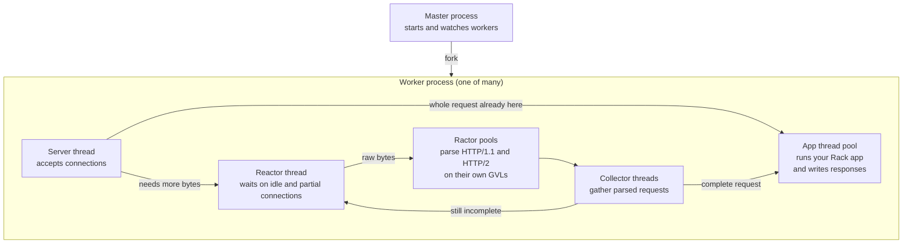

Let's walk through each piece.

<br>
<br>
<br>
<br>
<br>
<br>
<br>
<br>

---

<br>
<br>
<br>
<br>
<br>
<br>
<br>
<br>

## The Ractor pools

Each protocol gets its own pool of parser Ractors. A coordinator hands work to whichever parser is free.

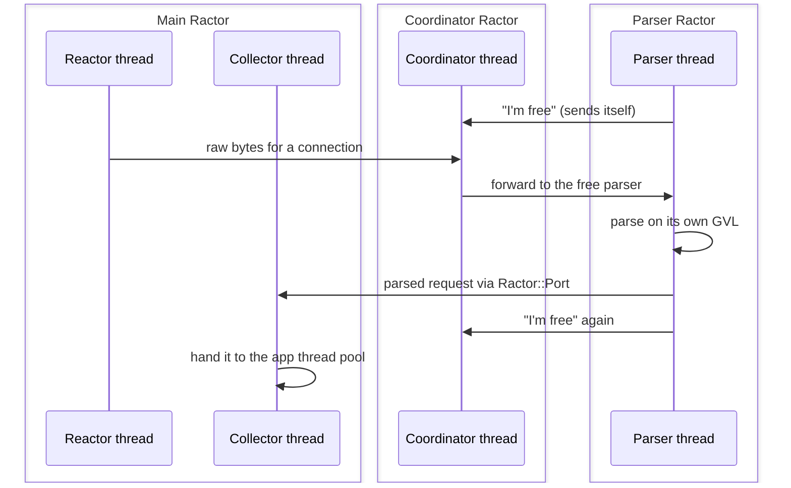

<big>Idle parsers send **themselves** back to the coordinator, so it always knows who's free without polling or busy-waiting.</big>

<big>The parsers are Ractor-safe C extensions, and common header names are created once and reused.</big>

I pulled this pattern out into its own gem, **[`ractor-pool`](https://github.com/joshuay03/ractor-pool)**.

<br>
<br>
<br>
<br>
<br>
<br>
<br>
<br>

---

<br>
<br>
<br>
<br>
<br>
<br>
<br>
<br>

## The app thread pool

This is where your Rack app runs.

Puma's pool is a queue guarded by a `Mutex`, so when things get busy, threads line up behind the lock.

Raptor's pool has **no locks** at all. To explain how, we need one tiny CPU instruction.

<br>
<br>
<br>
<br>
<br>
<br>
<br>
<br>

---

<br>
<br>
<br>
<br>
<br>
<br>
<br>
<br>

## Compare-and-swap (CAS)

"Set this value to **new**, but only if it's still **expected**." The CPU does it as one indivisible step.

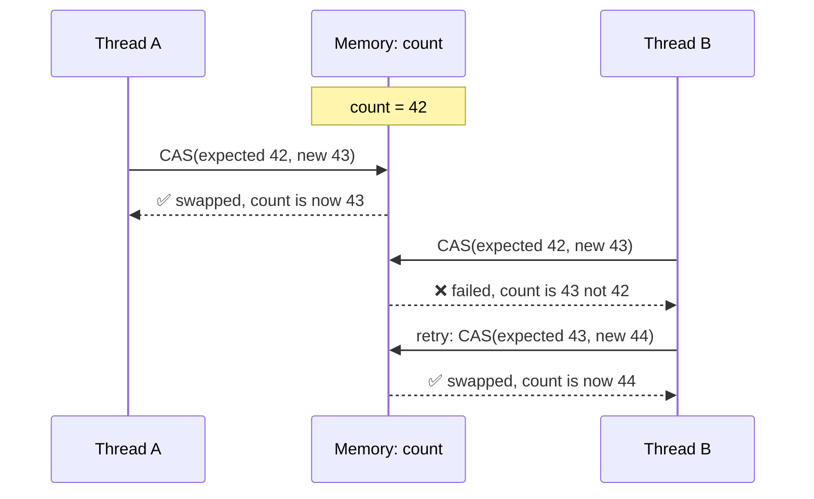

<big>Nobody waits on a lock. The loser just retries with the fresh value.</big>

<big>The catch is that it works on one value at a time, like a counter, a flag, or the head of a queue.</big>

A mutex is still simpler for bigger critical sections. CAS pays off on hot paths.

I wrote a native gem that brings these primitives to Ruby, **[`atomic-ruby`](https://github.com/joshuay03/atomic-ruby)**.

<br>
<br>
<br>
<br>
<br>
<br>
<br>
<br>

---

<br>
<br>
<br>
<br>
<br>
<br>
<br>
<br>

## A queue with no lock

Raptor's work queue is [`atomic-ruby`](https://github.com/joshuay03/atomic-ruby)'s `AtomicQueue`, a lock-free linked list where each step is a single CAS.

**Adding work C**

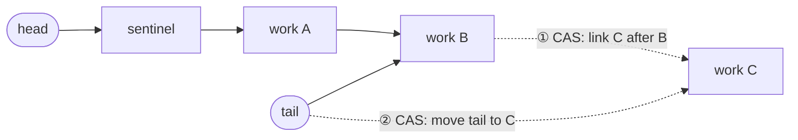

**Taking work**


<big>Adding and taking never block each other. If two threads race, one CAS wins and the other retries.</big>

<br>
<br>
<br>
<br>
<br>
<br>
<br>
<br>

---

<br>
<br>
<br>
<br>
<br>
<br>
<br>
<br>

## No mutexes at all

There isn't a single `Mutex` in Raptor's own code. Shared state is either owned by one thread, passed along as a message, or updated with CAS.

That's not only about speed. Under the GVL, a thread can be switched out at almost any point, including while it's holding a lock:

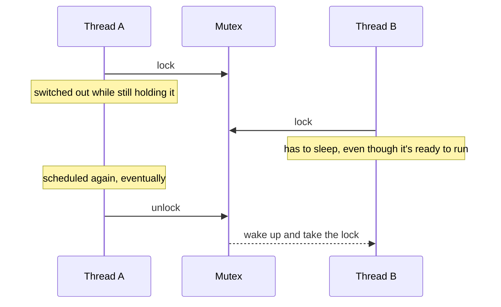

<big>Now every thread that needs the lock is waiting on one that isn't even running.</big>

<big>CAS has nothing to hold. A thread switched out mid-update can't block anyone, and if it lost the race, it just retries.</big>

It also means there's no lock ordering to get wrong, which is where deadlocks come from.

<br>
<br>
<br>
<br>
<br>
<br>
<br>
<br>

---

<br>
<br>
<br>
<br>
<br>
<br>
<br>
<br>

## How many threads?

Most requests spend their time waiting on the database or the network. More threads help with waiting, but not with running Ruby.

Raptor uses [`atomic-ruby`](https://github.com/joshuay03/atomic-ruby)'s `AtomicThreadPool`, which uses a CRuby hook to see what each thread is actually doing:

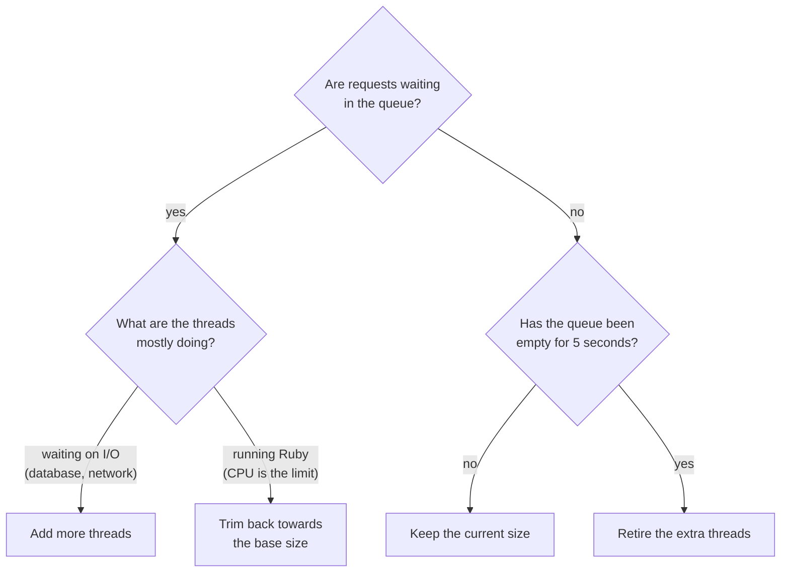

<big>It starts at `threads` (3 by default). Set `max_threads` to cap the growth, or match `threads` for a fixed pool.</big>

<br>
<br>
<br>
<br>
<br>
<br>
<br>
<br>

---

<br>
<br>
<br>
<br>
<br>
<br>
<br>
<br>

## The reactor

Some connections aren't ready to be read yet: slow clients, half-sent requests, idle keep-alive connections. The reactor watches all of them at once.

- <big>Built on [`nio4r`](https://github.com/socketry/nio4r) (`epoll` on Linux, `kqueue` on macOS), same as Puma</big>
- <big>Every connection also has a deadline:</big>
  - 30s to send the first bytes
  - 10s between chunks of a request
  - 65s idle between keep-alive requests

Every time a connection sends bytes, its deadline moves. So the reactor needs a cheap way to keep **thousands of deadlines in order**.

<br>
<br>
<br>
<br>
<br>
<br>
<br>
<br>

---

<br>
<br>
<br>
<br>
<br>
<br>
<br>
<br>

## Keeping deadlines in order

**Puma** keeps an `Array` and sorts it after changes. Sorting is O(n log n), and removing a specific connection means scanning the whole list.

**Raptor** keeps a **red-black tree**: a binary search tree that rebalances itself as it changes.

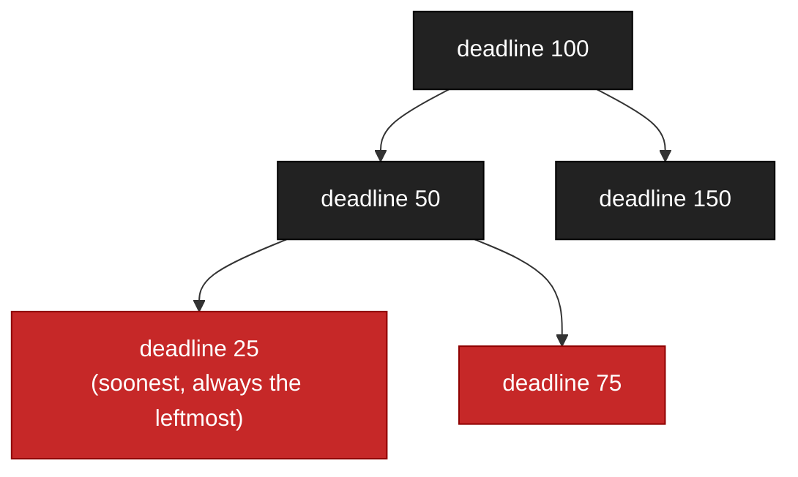

<big>Inserting, removing, and finding the soonest deadline are all O(log n). Expiring connections means walking from the leftmost node until one isn't due.</big>

With a hundred connections you wouldn't notice the difference, but it adds up once you have thousands.

That one became another gem, **[`red-black-tree`](https://github.com/joshuay03/red-black-tree)**.

<br>
<br>
<br>
<br>
<br>
<br>
<br>
<br>

---

<br>
<br>
<br>
<br>
<br>
<br>
<br>
<br>

## Writing the response

Once your app returns, the response still has to become bytes on the socket.

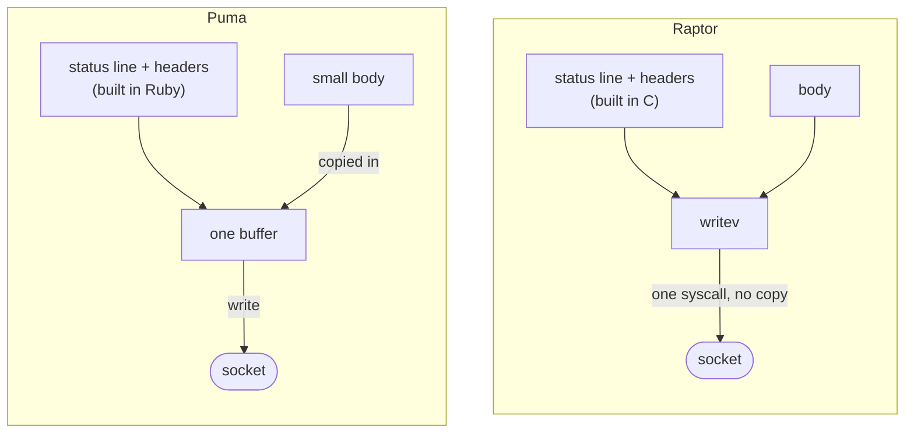

<big>Puma builds the response in Ruby, then either copies small bodies into its header buffer or corks the socket for larger ones.</big>

<big>Raptor builds it in C and sends the headers and body together with one `writev` call, without copying them into one string.</big>
<br>
<br>
<br>
<br>
<br>
<br>
<br>
<br>

---

<br>
<br>
<br>
<br>
<br>
<br>
<br>
<br>

## HTTP/2 in one slide

HTTP/1.1 sends one request at a time on a connection. HTTP/2 sends many at once, split into small binary frames:

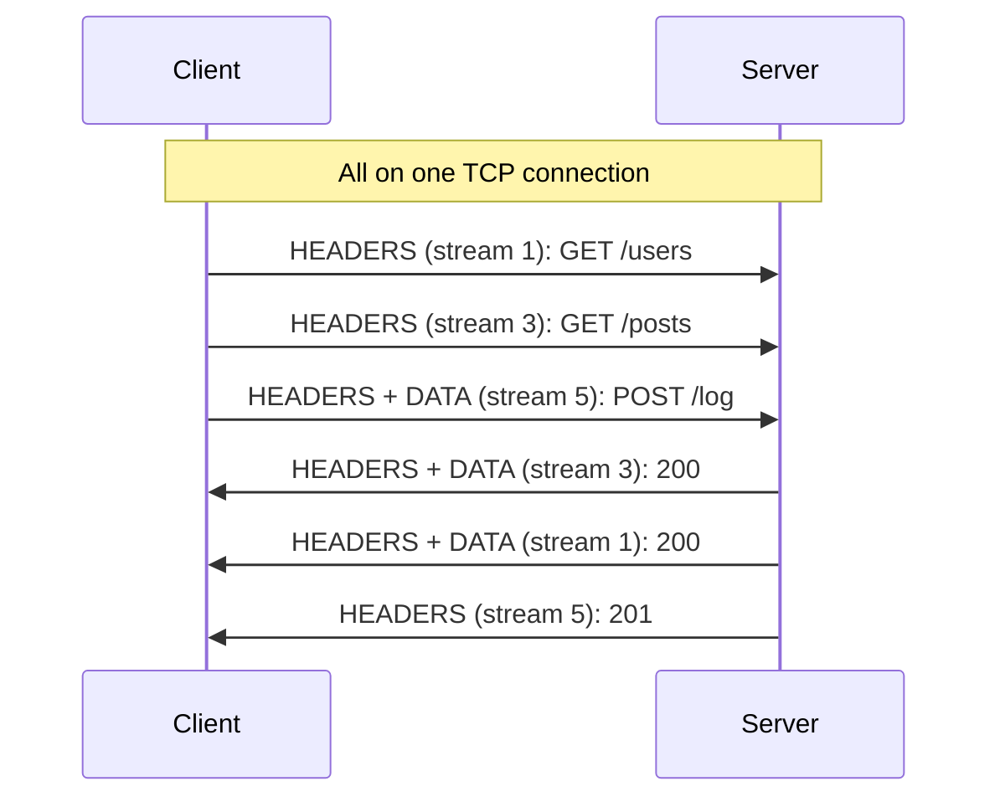

- <big>**Multiplexing**: many requests (streams) share one connection</big>
- <big>**Header compression** (HPACK): headers you've already sent become tiny numbers</big>
- <big>**Flow control**: each side says how much data it's ready to receive</big>

Raptor speaks HTTP/2 natively, and so does Falcon. Puma [leaves it to a proxy](https://github.com/puma/puma/issues/2697) like nginx.

<br>
<br>
<br>
<br>
<br>
<br>
<br>
<br>

---

<br>
<br>
<br>
<br>
<br>
<br>
<br>
<br>

## HTTP/2 in Raptor

<big>HTTP/2 gets its own C parser and Ractor pool. Each stream is its own job, so one connection can use several app threads.</big>

<big>Only the reactor ever writes to the socket. App threads hand it frames and carry on.</big>


<big>No thread ever waits for a slow client to read, and there's no lock around the socket because only one thread owns it.</big>

<br>
<br>
<br>
<br>
<br>
<br>
<br>
<br>

---

<br>
<br>
<br>
<br>
<br>
<br>
<br>
<br>

## Streams that outlive the request

Some responses stay open for minutes, like server-sent events or gRPC streams. Normally each one ties up an app thread the whole time.

Raptor's answer is `Raptor::DetachedBody`:

```ruby
run ->(env) {
  body = Raptor::DetachedBody.new
  body.on_open { Subscribers.add(body) }
  body.on_close { Subscribers.remove(body) }
  [200, { "content-type" => "text/event-stream" }, body]
}

# Later, from any thread
Subscribers.each { |body| body.try_write("data: update\n\n") }
```

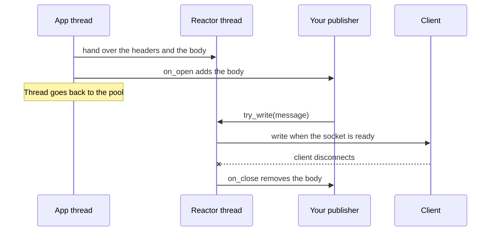

<big>The app thread returns straight away and the reactor owns the stream from then on. `try_write` never blocks.</big>

<big>When the client disconnects or the server shuts down, `on_close` runs immediately. It works over both HTTP/1.1 and HTTP/2.</big>

The first time I tried this at work, every new stream still held a thread for about 1.5ms. The handoff was polling, so I changed it to wake the thread instead.

<br>
<br>
<br>
<br>
<br>
<br>
<br>
<br>

---

<br>
<br>
<br>
<br>
<br>
<br>
<br>
<br>

## Enough HTTP/2 for gRPC

gRPC runs over HTTP/2 and relies on parts of it most apps never touch. Raptor supports them, so a `DetachedBody` can serve gRPC:

```ruby
body.try_write(encoded_message)
body.close(trailers: { "grpc-status" => "0" })
```

- <big>**Trailers**: headers sent after the body. gRPC puts its final status there, because it isn't known until the stream ends.</big>
- <big>**Cancellation**: when a client gives up on a stream, Raptor passes that on to your body straight away</big>
- <big>**Keepalive PINGs**: idle connections get pinged, so dead ones are noticed and closed</big>
- <big>**Graceful shutdown**: `GOAWAY` tells clients to stop opening new streams while the current ones finish</big>

<br>
<br>
<br>
<br>
<br>
<br>
<br>
<br>

---

<br>
<br>
<br>
<br>
<br>
<br>
<br>
<br>

## Zooming out: the processes

So far we've been inside one worker. Let's look at how the workers live together.

**Preforking**: the master loads your app once, then forks a copy for each worker.

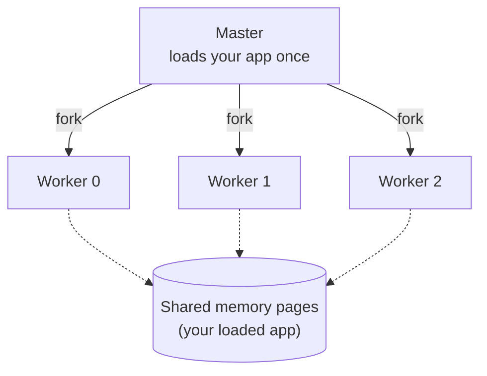

<big>Every worker starts out sharing the same memory, and a page is only copied when someone changes it. That's copy-on-write.</big>

<br>
<br>
<br>
<br>
<br>
<br>
<br>
<br>

---

<br>
<br>
<br>
<br>
<br>
<br>
<br>
<br>

## Refork

Copy-on-write savings fade as workers warm caches, compile YJIT code, and load gems lazily. Eventually each worker has its own copy of most pages.

The fix: periodically fork new workers from a **warm** worker instead of the master.

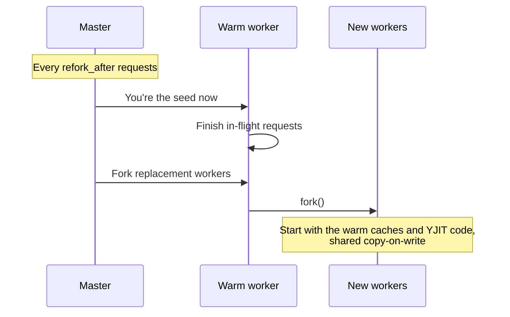

<big>The idea comes from Shopify's [Pitchfork](https://github.com/Shopify/pitchfork). Puma's version is the experimental `fork_worker`, which I've fixed a few bugs in.</big>

<big>It relies on `PR_SET_CHILD_SUBREAPER`, so the master can adopt workers it didn't fork. That makes it Linux only.</big>

<br>
<br>
<br>
<br>
<br>
<br>
<br>
<br>

---

<br>
<br>
<br>
<br>
<br>
<br>
<br>
<br>

## Shared memory for stats

The master needs to know how each worker is doing. Puma's workers report through pipes, while Raptor's write straight into shared memory.

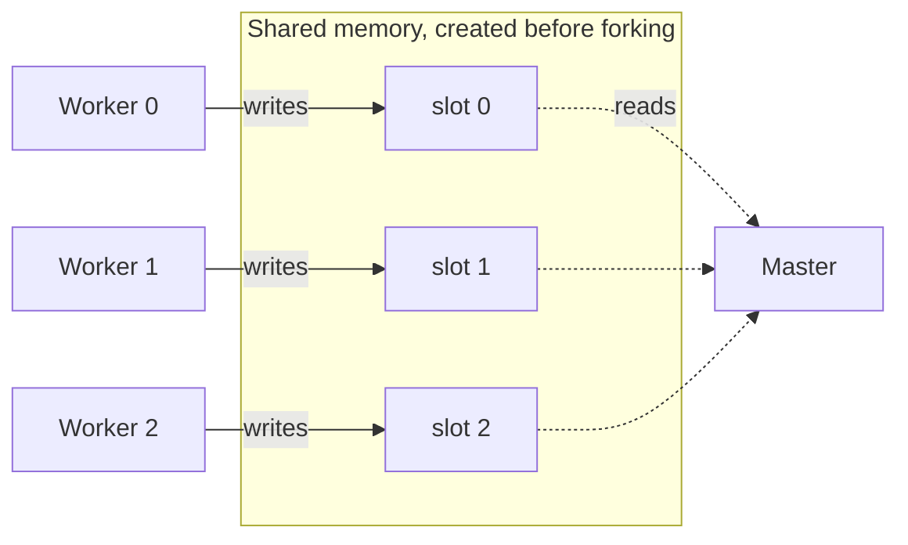

<big>The master creates the region with `mmap` before forking, so every worker inherits it. Each worker owns one 49-byte slot, so writes never clash.</big>

<big>Updating stats is just a write to memory, with no pipe, no parsing, and no syscall.</big>

That's where **[`mmap-ruby`](https://github.com/joshuay03/mmap-ruby)** came from.

<br>
<br>
<br>
<br>
<br>
<br>
<br>
<br>

---

<br>
<br>
<br>
<br>
<br>
<br>
<br>
<br>

## Which worker gets the next connection?

All workers listen on the same port, and by default Linux spreads connections by hashing the client's address. That's even **on average**, but blind to which workers are busy.

Puma nudges the odds. Busier workers pause briefly before accepting, so quieter ones tend to win.

Raptor lets the kernel decide using real load, with **BPF**.

<big>BPF lets you run tiny, kernel-verified programs inside Linux. It's the same technology behind `bpftrace` and Cilium.</big>

<br>
<br>
<br>
<br>
<br>
<br>
<br>
<br>

---

<br>
<br>
<br>
<br>
<br>
<br>
<br>
<br>

## Raptor's BPF program

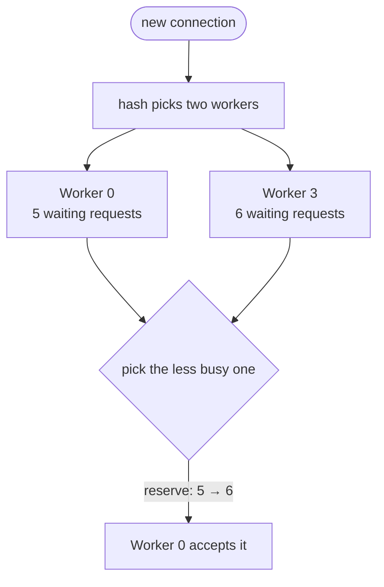

<big>Each worker publishes its load, including connections still waiting to be accepted, to a map the kernel can read. The program compares two workers and picks the quieter one ("power of two choices").</big>

<big>It bumps that worker's count straight away, so a burst doesn't all land on one worker.</big>

<big>The whole program is about 70 lines of C. If BPF isn't available, Raptor quietly falls back to the default behaviour.</big>

To load it from Ruby, I wrote **[`libbpf-ruby`](https://github.com/joshuay03/libbpf-ruby)**.

<br>
<br>
<br>
<br>
<br>
<br>
<br>
<br>

---

<br>
<br>
<br>
<br>
<br>
<br>
<br>
<br>

## Pinning workers to cores

Linux moves processes between cores whenever it likes, and each move lands a worker on cold caches.

<big>With `cpu_affinity` on, each worker pins itself to its own core and keeps its caches warm. Puma doesn't offer this.</big>

<big>It's opt-in, because a pinned worker's threads and Ractors share one core. I've seen it help, but I don't have numbers yet.</big>

<br>
<br>
<br>
<br>
<br>
<br>
<br>
<br>

---

<br>
<br>
<br>
<br>
<br>
<br>
<br>
<br>

## The numbers

Full results and the setup are in the [README](../README.md#micro-benchmarks). **I/O** requests mostly wait on fake database calls, and **CPU** requests mostly run Ruby.

- <big>**I/O-heavy HTTP/1.1 with 3 threads per worker**: roughly 1.8 to 2.1 times Puma's throughput</big>
  - Raptor polls for accept capacity under saturation. That trades CPU time for throughput and latency; the same thread count doesn't mean the same CPU use.
  - Existing keep-alive traffic can also delay new connections at saturation; throughput and p95 don't capture every client's wait.
- <big>**I/O-heavy HTTP/1.1 with scaling threads**: approximately tied with Puma</big>
  - Puma adds a thread whenever work is waiting. Raptor only adds one when the busy threads are blocked, to avoid adding threads CPU-heavy apps can't use.
- <big>**HTTP/2**: direct multiplexing, compared with Falcon</big>
  - Puma doesn't implement HTTP/2. Raptor and Falcon do; their numbers move around a lot between runs, so check the spread as well as the medians.
- <big>**I/O with server-sent events and 3 threads per worker**: 8.3 times Puma's throughput, with Puma also reporting timeouts</big>
  - A detached body hands the stream to the reactor, so the app thread is free again. On Puma, every open stream holds a thread until it closes.

Puma wins three of the four CPU-heavy HTTP/1.1 comparisons; Raptor leads slightly with scaling threads and keep-alive. These are micro benchmarks though, so benchmark your own application before choosing a server.

<br>
<br>
<br>
<br>
<br>
<br>
<br>
<br>

---

<br>
<br>
<br>
<br>
<br>
<br>
<br>
<br>

## What you give up

- <big>**Battle-testing**: Puma has run production Rails since 2011. Raptor is less than a year old.</big>
- <big>**Older Rubies**: Raptor needs Ruby 4.0.</big>
- <big>**Ractor overhead**: on Ruby 4.0, once a process starts a Ractor, the rest of its Ruby runs slower too. On the upcoming Ruby 4.1, it's gone in my measurements.</big>
- <big>**Easy debugging**: a request can cross threads and Ractors, so tracing it means stitching stack traces together.</big>

<br>
<br>
<br>
<br>
<br>
<br>
<br>
<br>

---

<br>
<br>
<br>
<br>
<br>
<br>
<br>
<br>

## Why it's worth being curious

I'm not asking you to swap your production server. What I hope you take away is how much more is possible from Ruby now:

- <big>Ractors are finally practical</big>
- <big>We can build lock-free data structures in Ruby</big>
- <big>We can share memory between processes with `mmap`</big>
- <big>We can load BPF programs into the kernel from Ruby</big>

None of these ideas are new on their own. What's new is that we can combine them in one Ruby server, and see how far that gets us.

<br>
<br>
<br>
<br>
<br>
<br>
<br>
<br>

---

<br>
<br>
<br>
<br>
<br>
<br>
<br>
<br>

## Try it

```
gem install raptor           # Ruby 4.0+
bundle exec raptor           # boots config.ru
bundle exec rails server -u raptor
```

- <big>The CLI mirrors Puma's on purpose</big>
- <big>Feedback and bug reports very welcome</big>

The long version of this talk, with much more detail, is [`docs/raptor-vs-puma.md`](raptor-vs-puma.md).

<br>
<br>
<br>
<br>
<br>
<br>
<br>
<br>

---

<br>
<br>
<br>
<br>
<br>
<br>
<br>
<br>

## Thanks

**Raptor**

[github.com/joshuay03/raptor](https://github.com/joshuay03/raptor)

**The gems that came out of it**

- <big>[`ractor-pool`](https://github.com/joshuay03/ractor-pool): a pool of Ractor workers</big>
- <big>[`atomic-ruby`](https://github.com/joshuay03/atomic-ruby): lock-free primitives and the thread pool</big>
- <big>[`red-black-tree`](https://github.com/joshuay03/red-black-tree): a self-balancing tree</big>
- <big>[`mmap-ruby`](https://github.com/joshuay03/mmap-ruby): shared memory</big>
- <big>[`libbpf-ruby`](https://github.com/joshuay03/libbpf-ruby): BPF from Ruby</big>

_Questions?_
